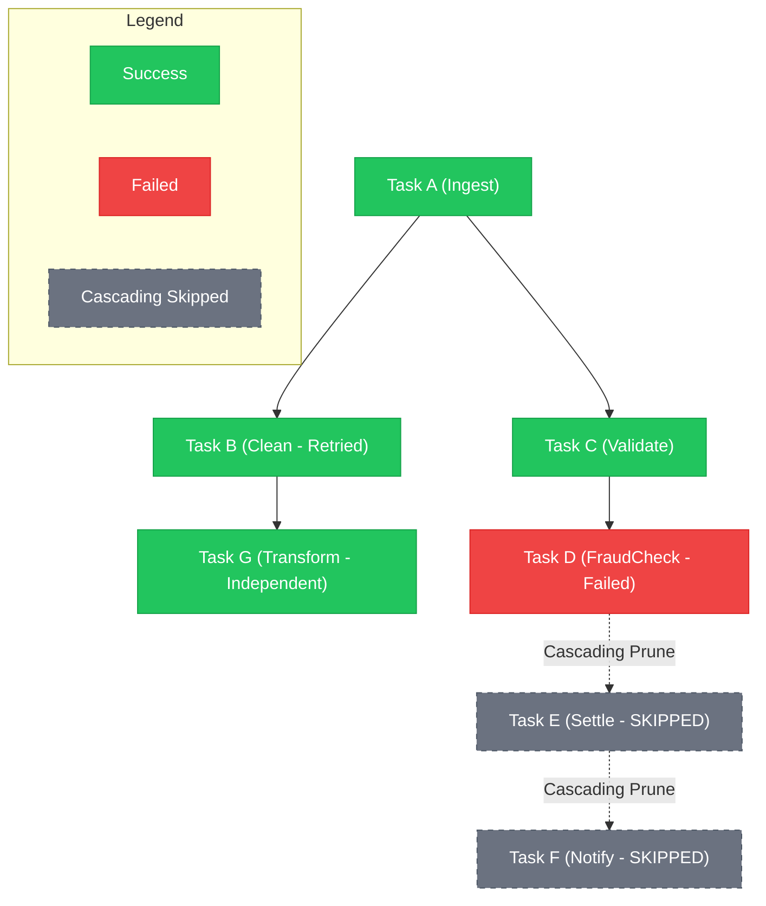
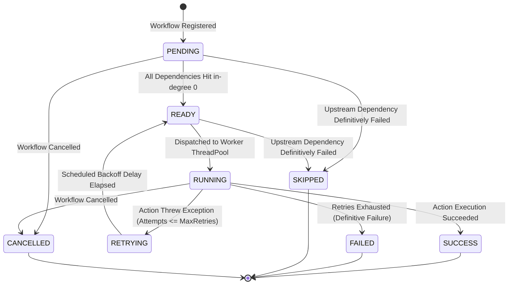
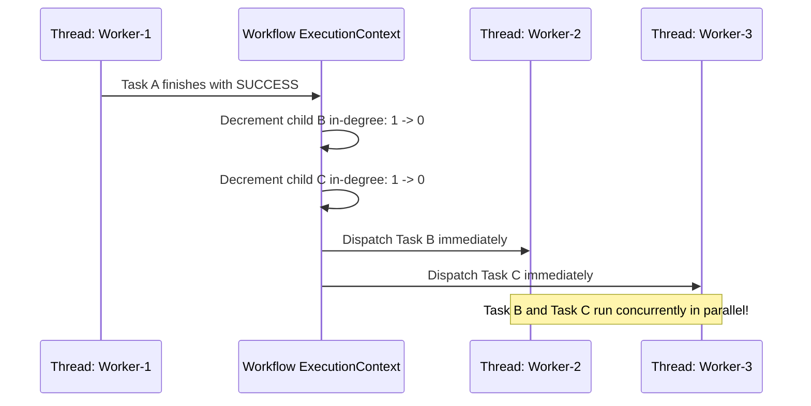

# High-Concurrency Dynamic DAG Workflow Execution Engine

A production-grade, low-latency, event-driven **Workflow Execution Engine** that models computational units as a **Directed Acyclic Graph (DAG)**, executes independent parallel branches concurrently, manages exponential backoff task retries, and deterministically prunes downstream tasks upon catastrophic failures.

---

## 1. Core Architecture & Mental Model

Modern distributed orchestration systems (like Apache Airflow, Temporal, AWS Step Functions, and Argo Workflows) coordinate complex multi-step pipelines. The core abstraction is a **Directed Acyclic Graph (DAG)**:
* **Nodes ($V$):** Computational tasks with executable business logic, timeouts, and retry policies.
* **Edges ($E$):** Directional dependencies ($A \to B$) requiring task $A$ to successfully complete before task $B$ can be dispatched.



---

## 2. Task Lifecycle State Machine

Every task transitions through an atomic state machine governed by CAS (**Compare-And-Swap**) primitives:



---

## 3. Pre-Execution DAG Validation (Kahn's Algorithm)

Before any thread is dispatched, the engine guarantees that the workflow is a valid Directed Acyclic Graph.

$$\text{DAG Invariant: No directed path } v_1 \to v_2 \to \dots \to v_k \text{ exists where } v_1 = v_k$$

### Kahn's Topological Sort Algorithm ($O(V + E)$ Time, $O(V)$ Space)
1. Calculate the **in-degree** ($\text{inDegree}[v]$) for every task $v \in V$.
2. Verify all referenced dependency task IDs exist; fail immediately if unmapped IDs or self-dependencies are detected.
3. Enqueue all tasks with $\text{inDegree}[v] == 0$ into a processing queue.
4. While the queue is non-empty:
   - Dequeue task $u$ and increment `visitedCount`.
   - For each downstream child $v \in \text{downstream}[u]$:
     - Decrement $\text{inDegree}[v]$.
     - If $\text{inDegree}[v] == 0$, enqueue $v$.
5. **Cycle Detection Invariant:** If `visitedCount != |V|`, the workflow contains at least one directed cycle! The remaining nodes with $\text{inDegree}[v] > 0$ pinpoint the cycle members.

---

## 4. High-Concurrency Dynamic Execution Engine

### Dynamic In-Degree Tracking Scheduler
Traditional naive engines poll the database or perform recurring scans. This engine uses **zero-polling, event-driven decrementing**:



* **Immediate Worker Dispatch:** As soon as an `AtomicInteger.decrementAndGet()` hits 0, `compareAndSet(PENDING, READY)` claims the task and submits it directly to the `workerPool`.

---

## 5. Resiliency & Failure Propagation Mechanics

### 1. Exponential Backoff with Jitter
For transient failures, retries use truncated exponential backoff with full randomized jitter to prevent the thundering herd problem:

$$T_{\text{wait}} = \min\left(T_{\text{max}}, T_{\text{initial}} \cdot \text{multiplier}^{\text{attempt}-1}\right) \times (1.0 + \text{jitter})$$

A dedicated daemon `ScheduledExecutorService` handles backoff sleeps without tying up worker threads.

### 2. Cascading Failure Downstream Pruning
When a task definitively fails (retries exhausted):
1. **Graph Traversal:** The engine conducts a BFS from the failed node across `downstreamMap` to discover all transitive descendants.
2. **Atomic Pruning:** For every reachable descendant:
   - Atomically transitions status to `SKIPPED`.
   - Injects a `TaskResult` indicating the exact upstream root cause.
   - Decrements the workflow's `remainingTerminalCount`.
3. **Independent Path Isolation:** Parallel branches that do NOT depend on the failed node continue running to completion uninterrupted.

---

## 6. Thread Safety & State Governance

| State Component | Concurrency Construct | Justification |
| :--- | :--- | :--- |
| **Task Statuses** | `ConcurrentHashMap<String, AtomicReference<TaskStatus>>` | Lock-free, atomic status transitions using `compareAndSet()`. |
| **In-Degree Counter** | `ConcurrentHashMap<String, AtomicInteger>` | Atomic thread-safe decrements across multiple parents completing concurrently. |
| **Downstream Adjacency** | `ConcurrentHashMap<String, List<String>>` | Thread-safe reads during child dispatching. |
| **Remaining Tasks Count** | `AtomicInteger` | Single atomic counter decremented on every terminal state (`SUCCESS`, `FAILED`, `SKIPPED`). Triggers clean workflow completion when hitting 0 without locks. |
| **Active Cancellations** | `AtomicBoolean` | Prevents subsequent attempts or scheduled retries from entering worker pools once cancelled. |

---

## 7. Runnable Code & Demo Execution

* **Source Code:** [`WorkflowEngine.java`](WorkflowEngine.java)
* **Compile and Run:**
```bash
javac WorkflowEngine.java
java concurrency_scheduling.dag_workflow_engine.WorkflowEngine
```
