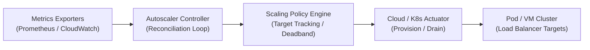
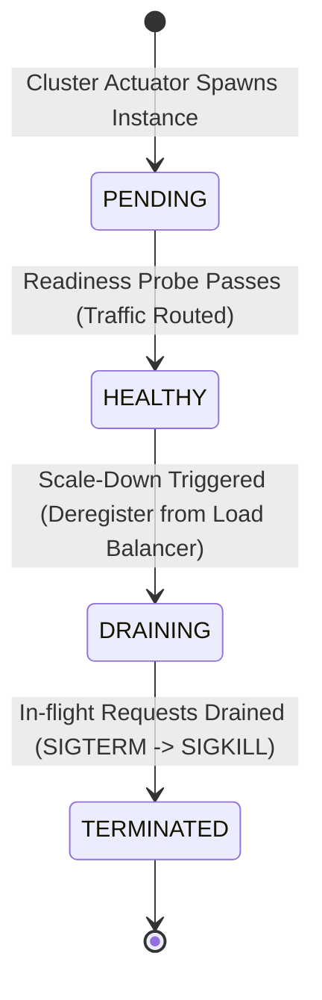
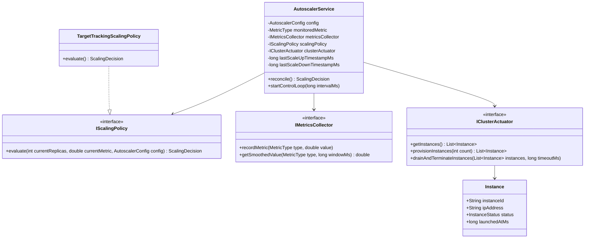

# Infrastructure Autoscaler System — LLD Deep Dive (Interview Edition)

> **Interview Difficulty:** Google / Amazon / Uber L5–L6 (Senior / Staff Systems Engineer)  
> **Core Patterns Used:** Strategy, Observer, Controller / Reconciler, Factory, State Pattern  
> **SOLID Coverage:** All 5 principles applied  
> **Key Technical Challenge:** Accurate target tracking scaling ($\mathcal{O}(1)$ reconciliation), anti-flapping hysteresis deadbands, cool-down stabilization windows, velocity step clamping, and graceful connection draining.

---

## 1. Problem Statement & Motivation

In modern cloud infrastructure (Kubernetes Horizontal Pod Autoscaler - **HPA**, AWS Auto Scaling Groups - **ASG**, and Google Cloud Instance Groups), application workloads experience dynamic traffic fluctuations:



Without an intelligent autoscaler, systems either:
1. **Over-provision:** Massive cloud bills during low-traffic nights.
2. **Under-provision:** Cascading request timeouts, 503 Service Unavailable, and dropped transactions during surges.
3. **Flap / Thrash:** Rapid, uncontrolled oscillation scaling up and down every few seconds, exhausting VM boot limits and overloading load balancers.

---

## 2. Mathematical Scaling Models & Invariants

### 1. Target Tracking Formula (The Kubernetes Invariant)

$$\text{DesiredReplicas} = \left\lceil \text{CurrentHealthyReplicas} \times \left( \frac{\text{CurrentSmoothedMetricValue}}{\text{TargetMetricValue}} \right) \right\rceil$$

### 2. Hysteresis Deadband (Anti-Flapping Invariant)
To prevent thrashing when a metric hovers near the target (e.g. CPU fluctuating between 48% and 52% on a 50% target):

$$\text{If } \left| \frac{\text{CurrentMetric} - \text{TargetMetric}}{\text{TargetMetric}} \right| \le \text{ToleranceDeadband} \implies \text{NO\_ACTION}$$

### 3. Cool-Down / Stabilization Windows
Cloud instances require minutes to initialize JVMs, download containers, and warm up caches:
* **Scale-Up Cooldown:** Suppresses consecutive scale-up commands within $T_{\text{scaleUpCooldown}}$ (e.g., 15–30 seconds) to allow freshly spawned replicas to absorb load.
* **Scale-Down Cooldown:** Conservative window (e.g., 300 seconds) requiring metrics to remain low over an extended duration before terminating nodes.

### 4. Step Scaling & Velocity Clamping
$$\text{Delta}_{\text{scaleUp}} = \min(\text{RawDelta}, \text{MaxScaleUpStep})$$
$$\text{Delta}_{\text{scaleDown}} = \min(|\text{RawDelta}|, \text{MaxScaleDownStep})$$
$$\text{ClampedDesired} = \max(\text{MinReplicas}, \min(\text{MaxReplicas}, \text{DesiredReplicas}))$$

---

## 3. Instance Lifecycle State Machine

Instances must be safely registered and deregistered from reverse proxies (Envoy, NGINX, ALB):



1. **`PENDING`:** VM is booting, container images pulling, health check probes failing.
2. **`HEALTHY`:** Registered to load balancer target group; actively processing production traffic.
3. **`DRAINING`:** Deregistered from target group. No new requests routed. In-flight requests are allowed to finish within `drainingTimeoutMs`.
4. **`TERMINATED`:** Cloud compute resources released.

---

## 4. Class Diagram & Architecture



---

## 5. Design Patterns Applied

| Pattern | Implementation Component | Why It Was Chosen |
| :--- | :--- | :--- |
| **Strategy Pattern** | `IScalingPolicy` (`TargetTrackingScalingPolicy`, `StepScalingPolicy`) | Allows swapping scaling algorithms (CPU vs SQS Backlog vs Memory) at runtime without altering the controller loop. |
| **Controller / Reconciler Pattern** | `AutoscalerService.reconcile()` | Reconciles actual state against desired state periodically, identical to the Kubernetes control plane. |
| **Observer / Registry Pattern** | `MetricsRegistry` & `IMetricsCollector` | Decouples time-series ingestion from scaling policy evaluations; applies windowed smoothing (EWMA). |
| **Hardware Abstraction Layer (HAL)** | `IClusterActuator` | Isolates scaling math from cloud provider APIs (Kubernetes API server, AWS EC2, GCP Compute Engine). |
| **Builder Pattern** | `AutoscalerConfig.Builder` | Fluent construction of complex multi-boundary configuration constraints. |

---

## 6. Verification & Demo Output

The complete implementation is available in [`AutoscalerSystem.java`](AutoscalerSystem.java).

```bash
javac AutoscalerSystem.java
java infrastructure.autoscaler.AutoscalerSystem
```

### Verified Scenarios:
1. **Steady-State Traffic:** CPU at 52% (target 50%, deadband $\pm 10\%$) $\to$ `[NO_ACTION]`.
2. **Surge Scaling:** CPU spikes to 90% $\to$ `[SCALE_UP] Scaling 3 -> 5 (+2 replicas)`.
3. **Cooldown Guardrail:** Immediate follow-up surge is suppressed during the 1500ms cool-down.
4. **Boundary Clamping:** Extreme surge to 100% CPU clamps desired replicas at `maxReplicas = 10`.
5. **Anti-Flapping:** Oscillation at 49% CPU is safely ignored within the deadband.
6. **Graceful Downscaling:** Traffic collapse to 15% CPU step-clamps downscale and safely drains instances.
