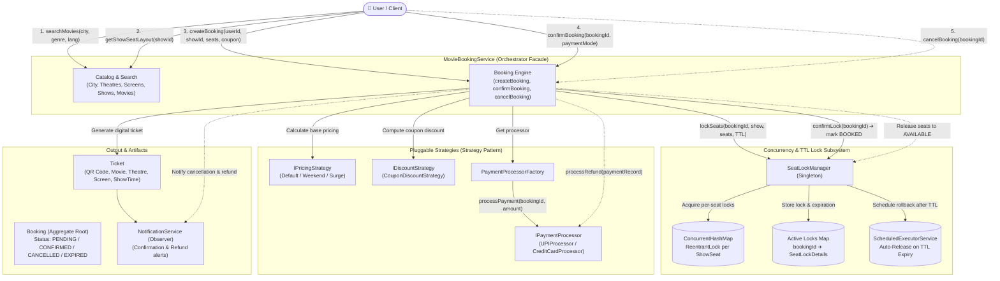
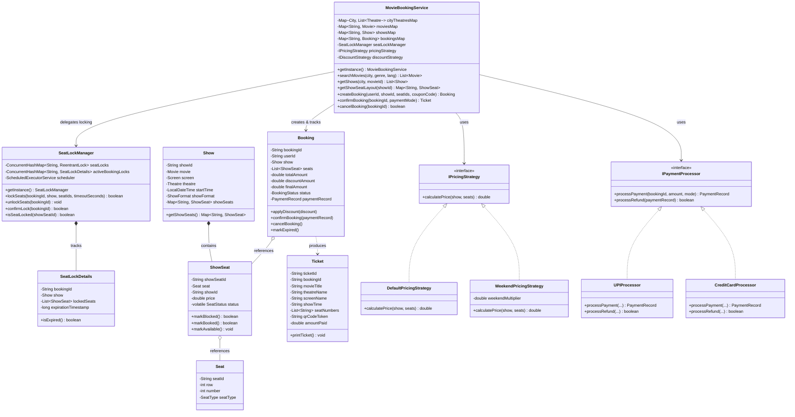
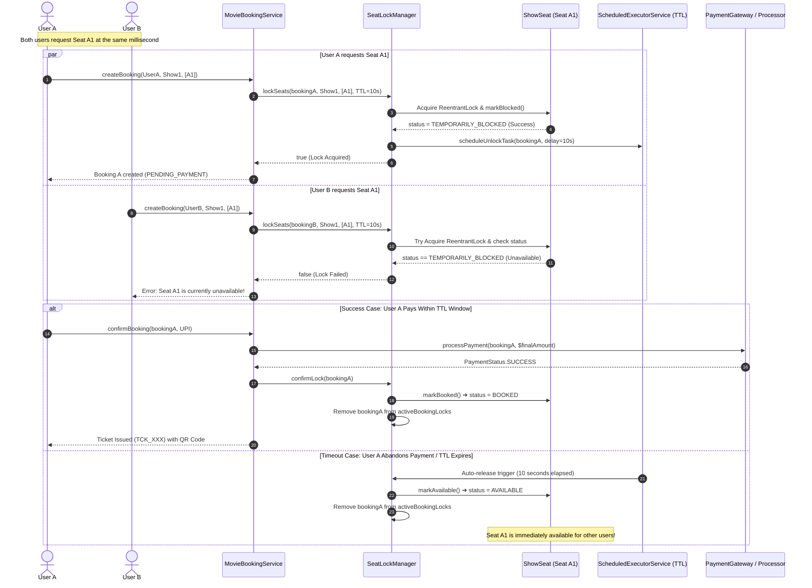
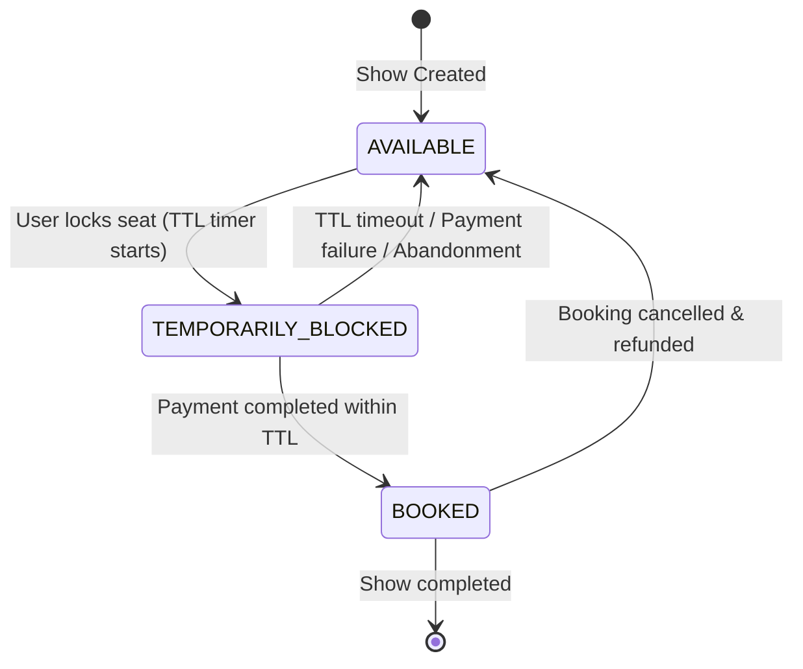
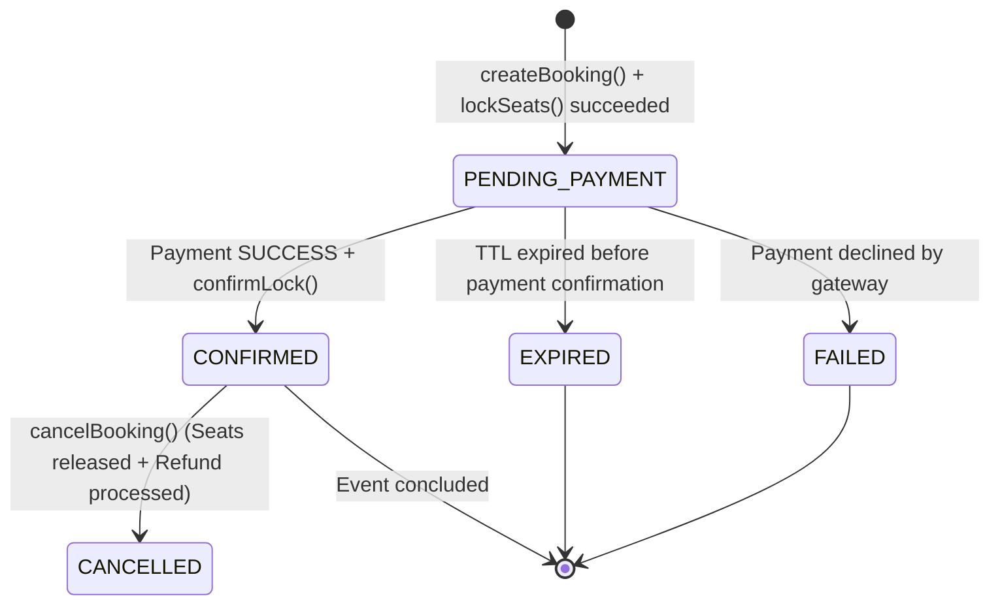
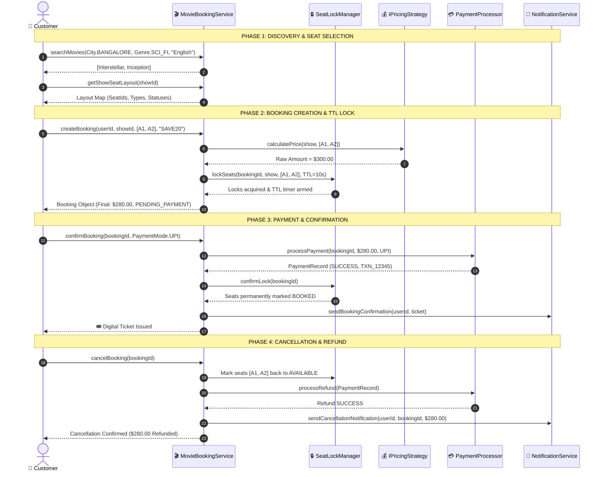

# Movie Booking System — Architecture & Design Diagrams (Mermaid)

> **Module:** `/02_system_design/lld/03_system_designs/resource_booking/movie_booking_system`  
> **Topic:** Comprehensive visual models (Flowcharts, Class Diagrams, Sequence Diagrams, and State Machines)

---

## 1. System Architecture & Component Interaction Flow

The `MovieBookingService` acts as a **Facade**, coordinating search catalogs, thread-safe seat locking with auto-expiration (TTL), pluggable pricing and discounts, payment processing, and notification emission.

---

## 2. Core Class Diagram & Domain Model

Details domain entities, associations, and strategy interfaces:

---

## 3. Concurrency & Race Condition Resolution (Two Users Booking Same Seat)

Shows the exact thread interactions when User A and User B concurrently compete for Seat A1, including the **TTL scheduled auto-release** if payment times out:

---

## 4. State Machines: Seat & Booking Lifecycles

### Seat State Transition (`SeatStatus`)

### Booking State Transition (`BookingStatus`)

---

## 5. End-to-End Happy Path & Cancellation Flow

