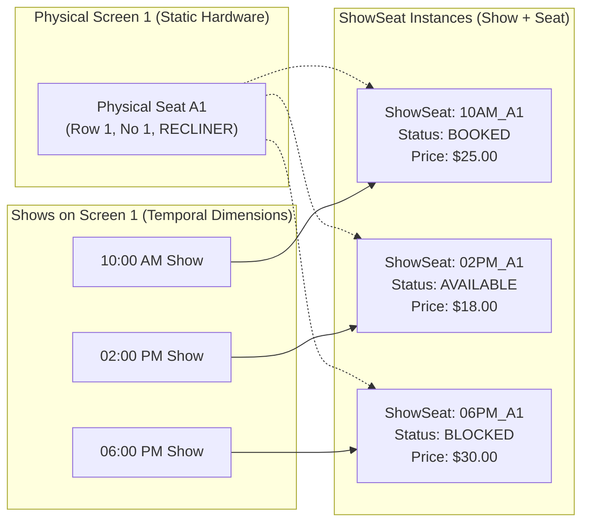

# Movie Booking System — Deep Dive Q&A & Interview Revision Notes

> **Module:** `/02_system_design/lld/03_system_designs/resource_booking/movie_booking_system`  
> **Topic:** Advanced Concurrency, Multi-Seat Locking, Memory Models, and Entity Modeling

---

## 📑 Table of Contents

1. [Q1: Why Keep a Mapping from Show to Seats (`Map<String, ShowSeat>`) Instead of Just Using Physical Screen Seats?](#q1-why-keep-a-mapping-from-show-to-seats-mapstring-showseat-instead-of-just-using-physical-screen-seats)
2. [Q2: Why Do We Have Both `seatLocks` and `activeBookingLocks`? Are They Two Locks?](#q2-why-do-we-have-both-seatlocks-and-activebookinglocks-are-they-two-locks)
3. [Q3: If `ShowSeat` Methods Are `synchronized`, Why Do We Still Need the `ReentrantLock` Mutex?](#q3-if-showseat-methods-are-synchronized-why-do-we-still-need-the-reentrantlock-mutex)
4. [Q4: If `ReentrantLock` Already Protects the Seat During Booking, Why Is `synchronized` Still Needed on State Updates?](#q4-if-reentrantlock-already-protects-the-seat-during-booking-why-is-synchronized-still-needed-on-state-updates)
5. [Summary: Senior / Staff Engineer Concurrency Cheatsheet](#summary-senior--staff-engineer-concurrency-cheatsheet)

---

## Q1: Why Keep a Mapping from Show to Seats (`Map<String, ShowSeat>`) Instead of Just Using Physical Screen Seats?

### The Code Reference
In `CoreModels.java`:
```java
public static class Show {
    ...
    private final Map<String, ShowSeat> showSeats;
}
```

### The Core Problem
A physical cinema screen has physical chairs (`Seat A1`, `Seat A2`, etc.). These chairs are **static physical assets** that do not change whether it is morning, afternoon, or night.

However, a single physical screen hosts **multiple screenings (shows)** throughout the day:
* `10:00 AM Show` (Interstellar)
* `02:00 PM Show` (Inception)
* `06:00 PM Show` (Oppenheimer)



### Key Architectural Reasons

#### 1. Temporal State Isolation
If `status` (`AVAILABLE`, `TEMPORARILY_BLOCKED`, `BOOKED`) were stored directly on `Seat`, booking Seat A1 for the 10:00 AM show would **falsely lock Seat A1 for the 2:00 PM and 6:00 PM shows as well**!
`ShowSeat` is an association entity:
$$\text{ShowSeat} = \text{Physical Seat} \times \text{Show Schedule}$$

#### 2. Dynamic Show-Specific Pricing
The exact same physical chair has different prices depending on:
* **Show Time:** Morning discount vs. Prime-time night surcharge.
* **Day of Week:** Weekday standard vs. Weekend surge.
* **Show Format:** 2D standard vs. IMAX 3D.
`ShowSeat` captures the calculated final price for *that specific screening*, leaving the physical `Seat` template untouched.

#### 3. Why `Map<String, ShowSeat>` instead of `List<ShowSeat>`?
* **$O(1)$ Lock & Checkout Lookups:** When a user checks out seats `["A1", "A2", "A3"]`, the system does:
  ```java
  ShowSeat ss = show.getShowSeats().get(seatId); // O(1) constant time
  ```
  With a `List<ShowSeat>`, validating 10 seats against a 500-seat cinema hall requires repeated $O(N)$ searches.
* **Concurrency Isolation:** Booking requests for different shows on the same physical screen operate on completely different `ShowSeat` memory instances, resulting in **zero lock contention across different shows**.

---

## Q2: Why Do We Have Both `seatLocks` and `activeBookingLocks`? Are They Two Locks?

### The Code Reference
In `SeatLockManager.java`:
```java
// 1. Thread synchronization mutexes
private final ConcurrentHashMap<String, ReentrantLock> seatLocks = new ConcurrentHashMap<>();

// 2. Active booking checkout sessions
private final ConcurrentHashMap<String, SeatLockDetails> activeBookingLocks = new ConcurrentHashMap<>();
```

### The Misconception
**They are NOT two concurrency locks.** They solve two completely different problems at two completely different time horizons and abstraction layers:

```
┌────────────────────────────────────────────────────────────────────────┐
│                              seatLocks                                 │
│  - Type: ConcurrentHashMap<String, ReentrantLock>                      │
│  - Scope: CPU / OS Thread Level                                        │
│  - Duration: ~1 to 5 MILLISECONDS                                      │
│  - Purpose: Prevent race conditions when updating seat status in RAM   │
└───────────────────────────────────┬────────────────────────────────────┘
                                    │ Held only while mutating state
                                    ▼
┌────────────────────────────────────────────────────────────────────────┐
│                         activeBookingLocks                             │
│  - Type: ConcurrentHashMap<String, SeatLockDetails>                    │
│  - Scope: Business Domain / Checkout Session Level                     │
│  - Duration: 5 to 10 MINUTES (TTL)                                     │
│  - Purpose: Track which user holds which seats while they pay           │
└────────────────────────────────────────────────────────────────────────┘
```

### Why You CANNOT Hold `ReentrantLock` During Payment
Holding a Java `ReentrantLock` for 10 minutes while waiting for a user to type credit card numbers and OTPs would:
1. Pin active worker threads or lock queues in the JVM.
2. Quickly exhaust the thread pool and freeze the application server.

### What Happens If You Remove Either One?
* **Remove `seatLocks`:** Two users clicking "Book" on Seat A1 at the exact same millisecond experience a race condition. Both threads read `AVAILABLE`, both mark it blocked, and both users get billed for the same seat (**Double-booking bug**).
* **Remove `activeBookingLocks`:** Once `lockSeats()` completes, the system forgets *which* seats belong to *which* booking. When the payment gateway webhook arrives with `bookingId = "BKG_123"`, you cannot confirm the seats. If the user abandons payment, the seats remain stuck in `TEMPORARILY_BLOCKED` forever (**Resource leak**).

---

## Q3: If `ShowSeat` Methods Are `synchronized`, Why Do We Still Need the `ReentrantLock` Mutex?

### The Code Reference
In `ShowSeat.java`:
```java
public synchronized boolean markBlocked() { ... }
public synchronized boolean markBooked() { ... }
public synchronized void markAvailable() { ... }
```
And in `SeatLockManager.java`:
```java
ReentrantLock lock = seatLocks.computeIfAbsent(ss.getShowSeatId(), k -> new ReentrantLock());
if (!lock.tryLock(2, TimeUnit.SECONDS)) { ... }
```

### The Key Insight: Single Seat vs. Multi-Seat Batching
If users only ever booked **1 single seat at a time**, `synchronized markBlocked()` would indeed suffice.

However, real cinema bookings involve **batches of seats** (e.g. `[A1, A2, A3]`). Relying solely on `synchronized` per seat fails in two catastrophic ways:

### 1. Multi-Seat Partial Inconsistency (Phantom / Dirty State)
Consider two users competing for overlapping seats:
* **User 1:** Wants `[A1, A2]`
* **User 2:** Wants `[A2, A3]`

Without the `ReentrantLock` coordination phase:
```
Time   User 1 (Thread 1: [A1, A2])        User 2 (Thread 2: [A2, A3])
-------------------------------------------------------------------------
T1     A1.markBlocked() -> SUCCESS
T2                                        A2.markBlocked() -> SUCCESS
T3     A2.markBlocked() -> FAILS!
T4     Thread 1 must abort & rollback:
       A1.markAvailable()
```
Between **T1 and T4**, Seat A1 was temporarily blocked and then rolled back. If **User 3** refreshed their browser at T2, **Seat A1 appeared unavailable to them for no legitimate reason**.

`SeatLockManager` uses a **Two-Phase Protocol**:
1. **Phase 1 (Lock Acquisition):** Acquire locks on `A1` and `A2` first. If any lock is unavailable, abort immediately.
2. **Phase 2 (State Mutation):** Only mutate statuses once the entire set of locks is secured. No partial modifications are ever visible to other users.

### 2. Deadlock Prevention & Timeouts (`tryLock`)
Java's `synchronized` keyword has two major drawbacks in production:
* **No timeout:** A thread blocked on `synchronized` waits indefinitely.
* **Non-interruptible:** A thread waiting for a monitor lock cannot be cancelled.

If User 1 books `[A1, A2]` and User 2 books `[A2, A1]`:
```java
// Thread 1: holds A1, waits for A2
// Thread 2: holds A2, waits for A1
// ==> DEADLOCK! Both threads frozen permanently.
```

With `ReentrantLock`:
1. **Deterministic Lock Ordering:** We sort seats by ID first (`seatsToLock.sort(...)`). All threads acquire locks in the exact same global order (`A1` before `A2`), eliminating circular wait conditions.
2. **Fail-Fast via `tryLock(2, TimeUnit.SECONDS)`:** If a lock is contested, the thread backs off after 2 seconds instead of hanging the HTTP connection.

---

## Q4: If `ReentrantLock` Already Protects the Seat During Booking, Why Is `synchronized` Still Needed on State Updates?

### The Nuance
Inside `lockSeats()`, thread T1 already holds the `ReentrantLock` for all target seats. Within `lockSeats()` alone, having `synchronized` on `markBlocked()` is technically redundant!

**So why is `synchronized` still necessary?**

### Reason: Other Callers Bypass `ReentrantLock` Completely!
Look at the rest of the system where seat statuses are updated:

#### 1. Payment Success Callback (`confirmLock`)
```java
public boolean confirmLock(String bookingId) {
    SeatLockDetails lockDetails = activeBookingLocks.remove(bookingId);
    for (ShowSeat ss : lockDetails.getLockedSeats()) {
        ss.markBooked(); // ⚠️ NO ReentrantLock IS ACQUIRED HERE!
    }
}
```

#### 2. The Background TTL Timer (`unlockSeats`)
```java
private void handleLockTimeout(String bookingId) {
    SeatLockDetails lockDetails = activeBookingLocks.remove(bookingId);
    for (ShowSeat ss : lockDetails.getLockedSeats()) {
        ss.markAvailable(); // ⚠️ RUNS ON SCHEDULED EXECUTOR THREAD, NO ReentrantLock!
    }
}
```

#### 3. User Cancellation & Refund (`cancelBooking`)
```java
public boolean cancelBooking(String bookingId) {
    for (ShowSeat ss : booking.getSeats()) {
        ss.markAvailable(); // ⚠️ NO ReentrantLock IS ACQUIRED HERE!
    }
}
```

### The Critical 9.999-Second Race Condition
Suppose the checkout timeout is 10 seconds:
* At **$T = 9.999\text{s}$**, User completes payment $\to$ Main thread calls `confirmLock()` $\to$ `ss.markBooked()`.
* At **$T = 10.000\text{s}$**, Background TTL timer fires $\to$ Worker thread calls `unlockSeats()` $\to$ `ss.markAvailable()`.

Both threads execute a **Check-Then-Act** mutation:
```java
// Thread 1 (Payment Confirm)
if (this.status == TEMPORARILY_BLOCKED) {
    this.status = BOOKED;
}

// Thread 2 (TTL Timeout)
if (this.status == TEMPORARILY_BLOCKED) {
    this.status = AVAILABLE;
}
```

If these methods were **NOT** `synchronized`:
1. Thread 1 reads `status` (`TEMPORARILY_BLOCKED`).
2. Context switch!
3. Thread 2 reads `status` (`TEMPORARILY_BLOCKED`).
4. Thread 1 sets `status = BOOKED`.
5. Thread 2 overwrites `status = AVAILABLE`.

💥 **Fatal Bug:** The customer's credit card was charged and they received a ticket confirmation, but the seat was reset to `AVAILABLE` and resold to another user!

`synchronized` prevents this race condition by making check-then-act atomic across payment and timeout threads.

---

## Summary: Senior / Staff Engineer Concurrency Cheatsheet

| Question / Challenge | Junior Solution | Senior / Staff Architect Solution |
|---|---|---|
| **Physical vs. Screening Seats** | Store availability flag on `Seat`. | Separate `Seat` (static layout) from `ShowSeat` (show-scoped price & temporal state). |
| **Seat Map Lookup** | `List<ShowSeat>` with linear search. | `Map<String, ShowSeat>` for $O(1)$ lock acquisition and cross-show isolation. |
| **Concurrency Lock Type** | Hold synchronized block through payment. | Two tiers: Millisecond `ReentrantLock` for state change + 10-minute `activeBookingLocks` for checkout TTL. |
| **Multi-Seat Deadlocks** | Lock seats in whatever order the user selected. | Sort seat IDs lexicographically before acquiring locks; use non-blocking `tryLock(timeout)`. |
| **Partial Allocation Leak** | Block seats one by one as checked. | Two-Phase: Acquire all locks first; mutate state only if entire batch succeeds. |
| **Payment vs. TTL Race** | Assume timer won't collide with payment. | Synchronized check-then-act transition (`TEMPORARILY_BLOCKED` $\to$ `BOOKED` vs `AVAILABLE`). |
