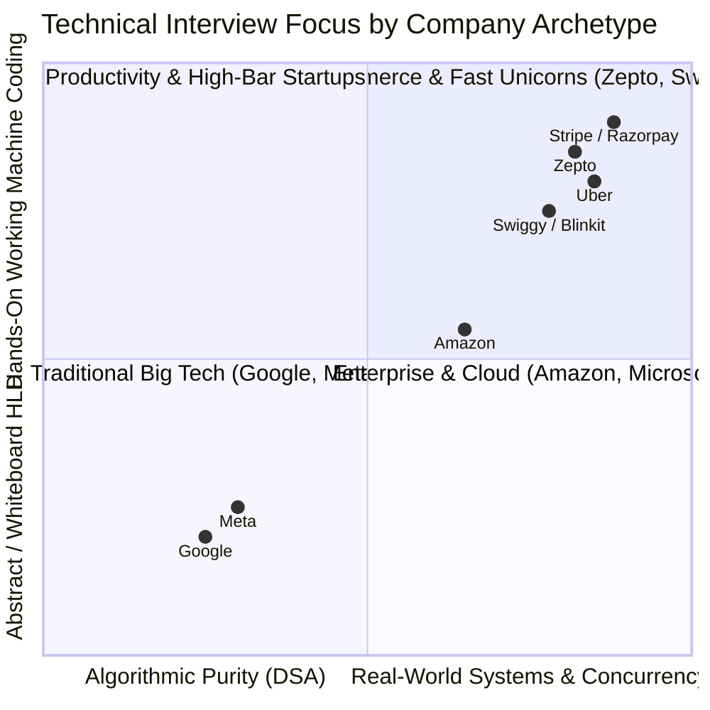

# 05. Company-Wise Technical Interview Preparation (SDE-2 / SDE-3 & Staff)

Welcome to the **Company-Wise Technical Interview Preparation** module. While core foundations (DSA, Concurrency, LLD, HLD, and Infrastructure) teach fundamental engineering principles, top-tier tech companies and hyper-growth unicorns evaluate candidates through distinct domain lenses, architectural cultures, and interview bar-raisers.

This module maps engineering knowledge directly to the specific interview loops, high-frequency question patterns, machine coding standards, and system design expectations of top tech companies.

> [!TIP]
> 📊 **Looking for compensation bands & difficulty ratings?**
> Refer to the dedicated guide: **[`company_tiers_salary_and_interview_difficulty.md`](company_tiers_salary_and_interview_difficulty.md)** — Comprehensive breakdown of 40+ product companies offering **₹30 LPA to ₹1.5+ Cr** across HFTs, Big Tech, US Unicorns, Indian Startups, and FinTech GICs.

---

## 🏢 Company Playbooks Index

| Company / Segment | Focus Tier | Primary Tech Domains | Common Round Formats | Playbook Link |
| :--- | :--- | :--- | :--- | :--- |
| **Zepto** | SDE-2 / SDE-3 / Lead | Quick Commerce, Dark Stores, High Concurrency, Microservices | DSA (Speed) + Machine Coding / LLD + HLD + BarRaiser | **[`zepto/`](zepto/README.md)** |
| **Swiggy & Zomato** | SDE-2 / SDE-3 / Architect | Food Delivery, Quick Commerce (Instamart/Blinkit), Surge Pricing | DSA + LLD + Distributed HLD + Tech Leadership | **[`swiggy_zomato/`](swiggy_zomato/README.md)** |
| **Uber & Ola** | SDE-2 / SDE-3 / Staff | Hyperlocal Logistics, Real-time GPS Streaming, H3 Geospatial | DSA + Complex Machine Coding + Geospatial HLD | **[`uber_ola/`](uber_ola/README.md)** |
| **Amazon & Flipkart** | SDE-2 / SDE-3 / Principal | E-commerce Scale, High Availability, Leadership Principles | DSA (Hard) + OOD/LLD + HLD + Bar Raiser (LP) | **[`amazon_flipkart/`](amazon_flipkart/README.md)** |
| **Stripe & Razorpay** | SDE-2 / SDE-3 / Staff | FinTech, Payment Gateways, Double-Entry Ledgers, Idempotency | DSA + Machine Coding (Ledger/Idempotency) + Financial HLD + BarRaiser | **[`stripe_razorpay/`](stripe_razorpay/README.md)** |
| **Google & Meta** | L4 (SDE-2) / L5 (Senior) | Massive Scale, In-memory Computing, Distributed Storage | DSA (Hard DP/Graphs) + High-Scale HLD + Behavioral | **[`google_meta/`](google_meta/README.md)** |

---

## 🎯 Archetype Breakdown: What Different Companies Value

### 1. The Quick-Commerce Archetype (Zepto, Blinkit, Instamart)
* **Core Philosophy:** *Zero Latency, High Concurrency, 10-Minute SLAs.*
* **DSA Focus:** High-speed problem solving. 2 Medium/Hard problems in 45 minutes (Graphs/BFS, Monotonic Stacks, Dynamic Programming).
* **LLD / Machine Coding:** You are expected to deliver compile-ready, runnable code within 90 minutes. Must handle race conditions, thread safety, and clean OOP separation.
* **HLD Focus:** Real-time inventory reservation, flash sales, dark store matching, order batching, and rider telemetry.
* **Database & Infra:** Relational row-level locking (`FOR UPDATE SKIP LOCKED`), Kafka partition keys, Redis caching strategies, and Outbox patterns.

### 2. The Global Hyper-Scale Archetype (Google, Meta)
* **Core Philosophy:** *Asymptotic Complexity, Global Distribution, Invariant Verification.*
* **DSA Focus:** Heavy emphasis on non-trivial Dynamic Programming, Graph algorithms, Topological Sorts, Trie structures, and mathematically sound time/space complexity derivations.
* **System Design:** Scale to billions of active users, global multi-region consistency, cross-datacenter replication lag, edge computing, and custom consensus (Paxos/Spanner).

### 3. The Enterprise & E-Commerce Archetype (Amazon, Flipkart)
* **Core Philosophy:** *Customer Obsession, Operational Excellence, Microservices Decomposition.*
* **DSA Focus:** Clean code, standard data structures (Trees, Hash Maps, Priority Queues, Binary Search).
* **Leadership Principles:** Half the interview weight is dedicated to behavioral behavioral leadership stories (STAR method).
* **System Design:** Shopping carts, fulfillment networks, DynamoDB single-table design, and resilient service orchestration (Saga/Step Functions).

### 4. The FinTech & Global Payment Gateway Archetype (Stripe, Razorpay)
* **Core Philosophy:** *Absolute Financial Invariants, Zero-Loss Durability, Exactly-Once Idempotency.*
* **DSA Focus:** Practical algorithms, interval trees, rate limiters, graph currency arbitrage, and robust string parsing.
* **LLD / Machine Coding:** Idempotent payment processors, double-entry multi-currency ledgers ($\sum \text{Debits} = \sum \text{Credits}$), sliding window rate limiters.
* **HLD Focus:** Payment gateway smart routing, bank fallback cascades, transactional outbox for webhooks, and 3-way automated financial reconciliation.
* **Database & Infra:** Postgres MVCC, distributed locks, immutable append-only ledger logs, Kafka event streaming, and HMAC-SHA256 signature verification.

---

## 🗺️ Cross-Referenced Master Modules

When preparing for a specific company, cross-reference these core sections of the **2026 Master Repository**:

* **For DSA Speed & Patterns:**
  * [`01_core_foundations/dsa/`](../01_core_foundations/dsa/README.md)
  * [`01_core_foundations/dsa/array/06_top50_problems.md`](../01_core_foundations/dsa/array/06_top50_problems.md) (with Interview Frequency Badges)
* **For Machine Coding & LLD:**
  * [`02_system_design/lld/01_foundations/`](../02_system_design/lld/01_foundations/) (SOLID & Clean OOP)
  * [`02_system_design/lld/02_design_patterns/`](../02_system_design/lld/02_design_patterns/) (GoF Patterns)
  * [`02_system_design/lld/03_system_designs/`](../02_system_design/lld/03_system_designs/) (Elevator, LRU, Parking Lot)
* **For High-Level System Design (HLD):**
  * [`02_system_design/hld/01_system_design_interview_framework.md`](../02_system_design/hld/01_system_design_interview_framework.md) (4-Step Interview Framework)
  * [`02_system_design/hld/03_distributed_rate_limiter.md`](../02_system_design/hld/03_distributed_rate_limiter.md)
  * [`02_system_design/hld/06_chat_messaging_system_whatsapp.md`](../02_system_design/hld/06_chat_messaging_system_whatsapp.md)
* **For Database & Middleware Deep Dives:**
  * [`03_systems_and_databases/ddia_book_study/`](../03_systems_and_databases/ddia_book_study/README.md)
  * [`04_infrastructure/tech-stack/kafka/`](../04_infrastructure/tech-stack/kafka/README.md)
  * [`04_infrastructure/tech-stack/redis/`](../04_infrastructure/tech-stack/redis/README.md)
  * [`04_infrastructure/tech-stack/postgres/`](../04_infrastructure/tech-stack/postgres/README.md)
