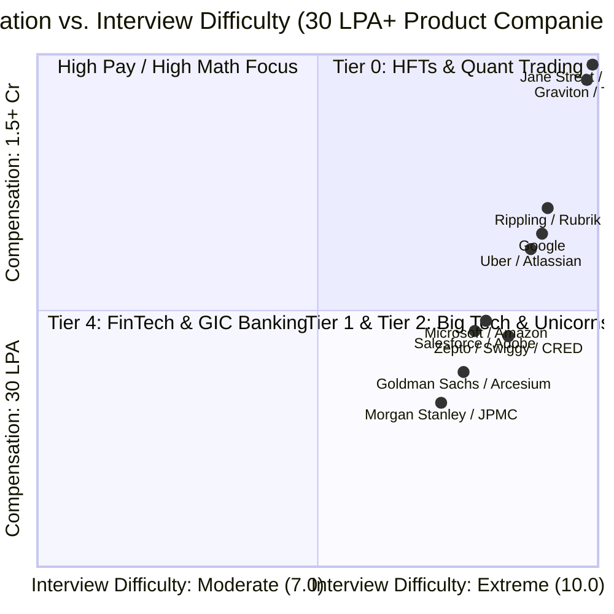

# Top Product-Based Companies in India (30 LPA+ Minimum)
## Segregation by Salary Bands and Interview Difficulty

This playbook categorizes leading product-based companies and tech organizations in India offering compensation packages starting from **30 LPA to 1.5+ Cr+** (across SDE-1, SDE-2, and Senior roles). 

Companies are segregated by **Compensation Structure (CTC vs. Base vs. Stock/Bonus)** and **Interview Difficulty (1 to 10 Scale)**, detailing the specific evaluation loops, domain expectations, and bar-raiser standards.

---

## 📊 Landscape Overview: Compensation vs. Interview Difficulty

---

## 🏆 Tier 0: High-Frequency Trading (HFT) & Quantitative Firms

*The absolute peak of engineering compensation in India. Offers are predominantly hard cash with high upfront signing and annual performance bonuses.*

* **Compensation (CTC)**: **70 LPA – 1.5+ Cr**
  * **Base Pay**: ₹45L – ₹75L+ (Cash)
  * **Bonus / Variable**: ₹25L – ₹70L+ (Performance/Trading Bonus)
* **Interview Difficulty**: **9.5 – 10 / 10 (Extreme / Elite)**
* **Hiring Companies**:
  * **Graviton Research Capital** (Gurugram)
  * **Tower Research Capital** (Gurugram)
  * **Quadeye** (Gurugram)
  * **NK Securities** (Gurugram)
  * **Jane Street** (Global / Remote / Campus)
  * **Jump Trading** (Gurugram / Mumbai)
  * **Hudson River Trading (HRT)** (Gurugram)
  * **Da Vinci Derivatives** (Mumbai)
  * **D. E. Shaw & Co.** (Quant & Core Systems Teams, Hyderabad/Bengaluru)
* **Interview Format & What They Test**:
  1. **Advanced Competitive Programming**: Codeforces Candidate Master / Master level (1900–2200+ rating). Hard segment trees, Fenwick trees, centroid decomposition, dynamic programming over subsets.
  2. **Low-Latency & Systems Internals**: Extreme Modern C++ (C++20), lock-free queues, cache line alignment (`cache_line_size`), false sharing, zero-copy socket programming, memory fences, kernel bypass (Solarflare OpenOnload, DPDK).
  3. **Math, Probability & Puzzles**: Conditional probability, Bayes' theorem, Markov chains, stochastic calculus, game theory, brain teasers.

---

## 🚀 Tier 1: Elite Big Tech & US Hypergrowth Scaleups

*Global tech leaders and tier-1 US tech innovators offering massive public market RSUs (NASDAQ/NYSE liquid equity) and generous refreshers.*

* **Compensation (CTC)**: **45 LPA – 75+ LPA**
  * **Base Pay**: ₹26L – ₹44L
  * **Stocks (RSUs)**: \$25,000 – \$50,000/year (USD-backed, liquid)
  * **Signing Bonus**: ₹3L – ₹10L
* **Interview Difficulty**: **8.8 – 9.5 / 10 (Very Hard)**
* **Hiring Companies**:
  * **Google** (Bengaluru, Hyderabad)
  * **Uber** (Bengaluru, Hyderabad)
  * **Atlassian** (Bengaluru, Remote India)
  * **Rubrik** (Bengaluru)
  * **Rippling** (Bengaluru)
  * **Databricks** (Bengaluru)
  * **Snowflake** (Bengaluru, Pune)
  * **Stripe** (Bengaluru, Remote India)
  * **LinkedIn** (Bengaluru)
  * **Apple** (Hyderabad, Bengaluru)
  * **Meta** (Select remote / specialised enterprise teams)
* **Interview Format & What They Test**:
  1. **DSA Rounds (2 to 3 rounds)**: LeetCode Hard and complex Mediums. Heavy emphasis on Graph traversals, Topological Sort, Shortest Paths (Dijkstra, Bellman-Ford), Trie + DP, Monotonic Deques. Clean, bug-free code with exact time and space complexity proofs.
  2. **Concurrency & Thread Safety**: Multi-threaded producer-consumer, reader-writer locks, deadlock detection, thread pools, memory consistency models.
  3. **Planetary High-Level Design (HLD)**: Globally distributed databases (Spanner, CockroachDB), multi-region active-active failover, consistency models (Linearizability vs Eventual), distributed rate limiting, and write-heavy telemetry streams.
  4. **Culture / Values / Bar Raiser**: High-standard behavioral evaluations (Googleyness, Atlassian Values, Uber Norms).

---

## 🏢 Tier 2: Global Tech Giants & Leading Enterprise SaaS

*Pillars of enterprise computing, cloud platforms, and established SaaS businesses with mature engineering ladders, strong work-life balance, and reliable stock grants.*

* **Compensation (CTC)**: **32 LPA – 52 LPA**
  * **Base Pay**: ₹20L – ₹33L
  * **Stocks (RSUs)**: \$15,000 – \$30,000/year (vesting 25% annually or tiered)
  * **Performance Bonus**: 10% – 20% of base
* **Interview Difficulty**: **7.8 – 8.6 / 10 (Hard)**
* **Hiring Companies**:
  * **Microsoft** (Hyderabad, Bengaluru, Noida)
  * **Amazon** (Bengaluru, Hyderabad, Chennai, Delhi NCR)
  * **Salesforce** (Hyderabad, Bengaluru)
  * **Adobe** (Noida, Bengaluru)
  * **Intuit** (Bengaluru)
  * **ServiceNow** (Hyderabad)
  * **Twilio** (Bengaluru, Remote)
  * **Confluent** (Bengaluru)
  * **Palo Alto Networks** (Bengaluru)
  * **Oracle Cloud Infrastructure (OCI)** (Bengaluru, Hyderabad)
  * **Cisco** (Security & Enterprise Cloud BUs, Bengaluru)
  * **VMware / Broadcom** (Bengaluru)
  * **PayPal** (Bengaluru, Chennai)
* **Interview Format & What They Test**:
  1. **DSA Rounds (2 rounds)**: Standard LeetCode Medium to Hard (Trees, BFS/DFS, Heaps, Dynamic Programming, Two Pointers). Amazon prioritizes clean modular syntax.
  2. **Low-Level Design (LLD / OOD)**: SOLID design principles, GoF design patterns (Strategy, Factory, Observer, Decorator), clean class diagrams, and exception handling.
  3. **High-Level Design (HLD)**: Microservices decomposition, database sharding, caching tiers (Redis), messaging queues (Kafka/RabbitMQ), and API gateway architecture.
  4. **Behavioral / Leadership Principles**: Amazon LP round (STAR method stories for Ownership, Customer Obsession, Bias for Action), Microsoft Cultural fitment.

---

## ⚡ Tier 3: Top Indian Unicorns & Quick-Commerce Scaleups

*Fast-paced consumer-tech startups known for massive transaction volumes, aggressive growth, high base pay, and substantial ESOP components.*

* **Compensation (CTC)**: **30 LPA – 50 LPA**
  * **Base Pay**: ₹22L – ₹38L (Aggressive cash component)
  * **ESOPs / Retention**: ₹8L – ₹20L over 4 years
  * **Joining Bonus**: ₹2L – ₹6L
* **Interview Difficulty**: **8.0 – 8.8 / 10 (Hard & Fast-Paced)**
* **Hiring Companies**:
  * **CRED** (Bengaluru)
  * **Swiggy** (Bengaluru, Remote)
  * **Zomato & Blinkit** (Gurugram)
  * **Zepto** (Bengaluru, Mumbai)
  * **Razorpay** (Bengaluru)
  * **PhonePe** (Bengaluru, Pune)
  * **Flipkart** (Bengaluru)
  * **Meesho** (Bengaluru)
  * **Urban Company** (Gurugram)
  * **InMobi** (Bengaluru)
  * **Groww** (Bengaluru)
* **Interview Format & What They Test**:
  1. **Machine Coding Round (90–120 Minutes)**: The defining round for Indian unicorns. Candidates must write functional, compile-ready, modular object-oriented code handling threading, concurrency, and extensibility (e.g., In-Memory Key-Value Store, Flash-Sale Inventory Locker, Splitwise, Ride Matching Engine).
  2. **DSA Speed Round**: 2 medium-hard questions within 45–60 minutes.
  3. **Practical High-Throughput HLD**: Real-world scale issues under 100k+ RPS, database row-level locking (`SELECT FOR UPDATE SKIP LOCKED`), Kafka partition assignment, idempotent payment APIs, Redis caching layers, and circuit breakers.
  4. **Hustle / Culture Fit**: Speed of execution, ownership mindset, and resilience under high ambiguity.

---

## 🏦 Tier 4: Global In-House Centers (GICs) & FinTech Tech Arms

*Technology divisions of top global investment banks and financial institutions offering high job stability, strong cash bonuses, and complex distributed transaction systems.*

* **Compensation (CTC)**: **30 LPA – 45 LPA**
  * **Base Pay**: ₹21L – ₹30L
  * **Annual Cash Bonus**: ₹5L – ₹15L (Pure cash bonus depending on bank performance)
  * **Signing Bonus**: ₹2L – ₹5L
* **Interview Difficulty**: **7.0 – 8.0 / 10 (Moderate to Hard)**
* **Hiring Companies**:
  * **Goldman Sachs** (Bengaluru, Hyderabad)
  * **Morgan Stanley** (Bengaluru, Mumbai)
  * **Arcesium** (Hyderabad, Bengaluru)
  * **J.P. Morgan Chase & Co.** (Bengaluru, Hyderabad, Mumbai — Senior / VP Tech Bands)
  * **American Express** (Gurugram, Bengaluru)
  * **BNY Mellon** (Pune, Chennai)
  * **Barclays** (Pune, Bengaluru — Tech Lead / VP bands)
  * **Fidelity Investments** (Bengaluru, Chennai — Principal / Staff bands)
  * **Deutsche Bank** (Pune, Bengaluru — Senior bands)
* **Interview Format & What They Test**:
  1. **Core CS Fundamentals**: Operating Systems (virtual memory, page tables, paging, CPU scheduling), DBMS (ACID, isolation levels, B-tree indexes, execution plans), and Computer Networks (TCP 3-way handshake, TCP vs UDP, TLS handshake).
  2. **Language Internals & JVM Mechanics**: Deep understanding of Java memory model (Garbage Collection algorithms like G1/ZGC, heap vs stack, JVM escape analysis) or C++ standard library.
  3. **DSA & Mathematical Puzzles**: LeetCode Medium algorithms (Binary Search variants, DP, Hash Tables) and quantitative logic puzzles.
  4. **FinTech System Design**: Eventual consistency vs strong consistency (Two-Phase Commit, Saga pattern), double-entry ledger design, audit trails, and financial reconciliation systems.

---

## 📋 Comprehensive Tier Matrix & Comparison

| Tier | Category | Sample Companies | Typical CTC Range | Base Pay Range | Difficulty (1-10) | Distinct Evaluation Focus |
| :--- | :--- | :--- | :--- | :--- | :--- | :--- |
| **Tier 0** | **HFT & Quant Trading** | Graviton, Tower Research, Quadeye, NK Securities, Jump Trading, Jane Street | **₹70L – ₹1.5+ Cr** | ₹45L – ₹75L+ | **9.8 / 10** | Competitive Programming, C++ low latency, OS memory bypass, Math/Puzzles |
| **Tier 1** | **Elite Big Tech & Scaleups** | Google, Uber, Atlassian, Rubrik, Rippling, Databricks, Snowflake, Stripe | **₹45L – ₹75+ LPA** | ₹26L – ₹44L | **9.2 / 10** | LeetCode Hard, Concurrency, Planetary Distributed Systems, Bar Raiser |
| **Tier 2** | **Big Tech & Enterprise SaaS** | Microsoft, Amazon, Salesforce, Adobe, Intuit, ServiceNow, Confluent, OCI | **₹32L – ₹52 LPA** | ₹20L – ₹33L | **8.2 / 10** | LC Medium/Hard, SOLID / LLD Patterns, HLD, Leadership Principles |
| **Tier 3** | **Indian Unicorns & Quick-Commerce** | Zepto, Swiggy, Zomato/Blinkit, CRED, Razorpay, PhonePe, Flipkart, Meesho | **₹30L – ₹50 LPA** | ₹22L – ₹38L | **8.4 / 10** | 120-min Working Machine Coding, Concurrency, Kafka, Fast Execution |
| **Tier 4** | **Investment Banks & FinTech GICs** | Goldman Sachs, Morgan Stanley, Arcesium, JPMC (VP Tech), Amex, BNY Mellon | **₹30L – ₹45 LPA** | ₹21L – ₹30L | **7.5 / 10** | Core CS (OS/DBMS/CN), JVM internals, Financial System Design, Puzzles |

---

## 🗺️ How to Prepare Using This Repository

Depending on which tier you are targeting, prioritize these modules from the **2026 Master Preparation Plan**:

1. **Targeting Tier 0 (HFT / Quant):**
   * Modern C++: [`01_core_foundations/cpp/`](../01_core_foundations/cpp_stl/) & [`01_core_foundations/cpp_concurrency_in_action/`](../01_core_foundations/cpp_concurrency_in_action/)
   * Low-Level OS: [`03_systems_and_databases/ostep/`](../03_systems_and_databases/ostep/)
   * Advanced Algorithms: [`01_core_foundations/cses/`](../01_core_foundations/cses/)

2. **Targeting Tier 1 & 2 (Big Tech / SaaS):**
   * DSA Patterns: [`01_core_foundations/dsa/`](../01_core_foundations/dsa/README.md)
   * High-Level Design (HLD): [`02_system_design/hld/`](../02_system_design/hld/01_system_design_interview_framework.md)
   * Detailed Company Playbooks:
     * [`05_company_prep/google_meta/`](google_meta/README.md)
     * [`05_company_prep/amazon_flipkart/`](amazon_flipkart/README.md)
     * [`05_company_prep/uber_ola/`](uber_ola/README.md)

3. **Targeting Tier 3 (Unicorns & Machine Coding):**
   * Machine Coding & Design Patterns: [`02_system_design/lld/`](../02_system_design/lld/)
   * Live Dark-Store & Real-Time Logistics Case Studies:
     * [`05_company_prep/zepto/`](zepto/README.md)
     * [`05_company_prep/swiggy_zomato/`](swiggy_zomato/README.md)
   * Distributed Infrastructure (Kafka, Redis, Postgres): [`04_infrastructure/tech-stack/`](../04_infrastructure/tech-stack/)

4. **Targeting Tier 4 (FinTech / I-Banks):**
   * Java Internals & JMM: [`01_core_foundations/java/`](../01_core_foundations/java/) & [`01_core_foundations/java_concurrency_in_practice/`](../01_core_foundations/java_concurrency_in_practice/)
   * Relational DB & ACID: [`03_systems_and_databases/database_system_concepts/`](../03_systems_and_databases/database_system_concepts/)
   * Distributed Transactions (Saga, 2PC): [`03_systems_and_databases/ddia_book_study/`](../03_systems_and_databases/ddia_book_study/)
