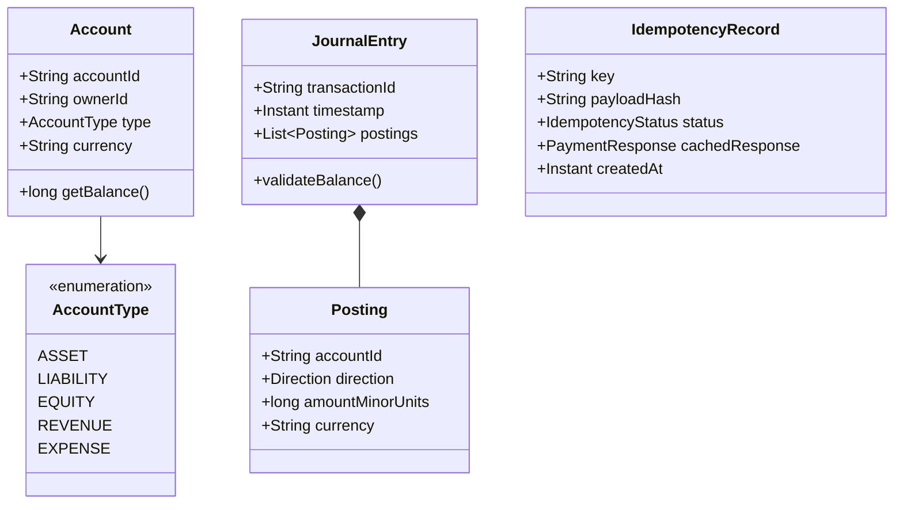

# Machine Coding: Idempotent Payment Processor & Double-Entry Ledger

In technical interviews at **Stripe** and **Razorpay**, the Machine Coding round is the ultimate separator between candidates who have merely memorized system design diagrams and engineers who possess deep **first-principles software craftsmanship**.

You are given **90 to 120 minutes** to build a functional, compile-ready, multi-threaded system in Java, Python, or Go.

---

## 🎯 Problem Statement

Design and implement an in-memory **Idempotent Payment Processor and Double-Entry Accounting Ledger Engine** that processes financial transactions with strict guarantees:

1. **Idempotency Guarantee:**
   - Every payment request carries an `idempotency_key` (UUID/string).
   - If the same key is received with the exact same payload while the first request is **IN_PROGRESS**, the second caller must wait or receive a 409 Conflict.
   - If the original request has already succeeded or failed, subsequent calls with the same key must return the **cached response without executing the financial transfer again**.
   - If a request arrives with a previously used key but a **different payload**, reject immediately with an `IdempotencyPayloadMismatchException`.
2. **Double-Entry Bookkeeping Ledger:**
   - No account balances can be stored as a mutable integer field updated directly.
   - A financial transaction consists of an immutable **Journal Entry** containing at least two balanced **Postings (Legs)**:
     $$\sum \text{Debits} = \sum \text{Credits}$$
   - Any transaction violating this zero-sum invariant must be rejected atomically.
3. **Currency & Precision Safety:**
   - Money must NEVER be represented as floating-point numbers (`float` or `double`). Use 64-bit integer amounts in the smallest currency unit (e.g., cents for USD, paise for INR).
4. **Concurrency Safety:**
   - Multiple threads concurrently executing transfers across the same accounts must never result in race conditions, negative balances (if overdraft disallowed), or balance drift.

---

## 📐 Domain Model & Class Diagram



---

## 💻 Production-Grade Java Implementation

Save this as a single file `PaymentEngine.java` to compile and run:

```java
import java.nio.charset.StandardCharsets;
import java.security.MessageDigest;
import java.security.NoSuchAlgorithmException;
import java.time.Instant;
import java.util.*;
import java.util.concurrent.*;
import java.util.concurrent.locks.ReentrantLock;

public class PaymentEngine {

    // =========================================================================
    // 1. Core Domain Types & Invariants
    // =========================================================================

    public enum AccountType {
        ASSET, LIABILITY, EQUITY, REVENUE, EXPENSE
    }

    public enum Direction {
        DEBIT, CREDIT
    }

    public enum IdempotencyStatus {
        IN_PROGRESS, SUCCESS, FAILED
    }

    public static class Account {
        private final String accountId;
        private final String ownerId;
        private final AccountType type;
        private final String currency;

        public Account(String accountId, String ownerId, AccountType type, String currency) {
            this.accountId = accountId;
            this.ownerId = ownerId;
            this.type = type;
            this.currency = currency;
        }

        public String getAccountId() { return accountId; }
        public String getCurrency() { return currency; }
        public AccountType getType() { return type; }
    }

    public static class Posting {
        private final String accountId;
        private final Direction direction;
        private final long amount; // Smallest unit (e.g. cents, paise)

        public Posting(String accountId, Direction direction, long amount) {
            if (amount <= 0) throw new IllegalArgumentException("Posting amount must be strictly positive");
            this.accountId = Objects.requireNonNull(accountId);
            this.direction = Objects.requireNonNull(direction);
            this.amount = amount;
        }

        public String getAccountId() { return accountId; }
        public Direction getDirection() { return direction; }
        public long getAmount() { return amount; }
    }

    public static class JournalEntry {
        private final String entryId;
        private final String transactionId;
        private final Instant timestamp;
        private final List<Posting> postings;

        public JournalEntry(String entryId, String transactionId, List<Posting> postings) {
            this.entryId = entryId;
            this.transactionId = transactionId;
            this.timestamp = Instant.now();
            this.postings = Collections.unmodifiableList(new ArrayList<>(postings));
            validateZeroSumBalance();
        }

        private void validateZeroSumBalance() {
            if (postings.size() < 2) {
                throw new IllegalStateException("A double-entry journal entry must have at least two postings");
            }
            long totalDebits = 0;
            long totalCredits = 0;
            for (Posting p : postings) {
                if (p.getDirection() == Direction.DEBIT) {
                    totalDebits += p.getAmount();
                } else {
                    totalCredits += p.getAmount();
                }
            }
            if (totalDebits != totalCredits) {
                throw new IllegalStateException(
                    String.format("Double-entry invariant violated: Debits (%d) != Credits (%d)", totalDebits, totalCredits)
                );
            }
        }

        public List<Posting> getPostings() { return postings; }
        public String getTransactionId() { return transactionId; }
    }

    // =========================================================================
    // 2. Double-Entry Ledger Engine
    // =========================================================================

    public static class LedgerService {
        private final Map<String, Account> accounts = new ConcurrentHashMap<>();
        // Immutable append-only log of all ledger entries
        private final List<JournalEntry> ledgerLog = new CopyOnWriteArrayList<>();
        private final Map<String, ReentrantLock> accountLocks = new ConcurrentHashMap<>();

        public void createAccount(Account account) {
            accounts.put(account.getAccountId(), account);
        }

        public Account getAccount(String accountId) {
            Account acc = accounts.get(accountId);
            if (acc == null) throw new NoSuchElementException("Account not found: " + accountId);
            return acc;
        }

        /**
         * Calculates current account balance from immutable posting history.
         * For ASSET & EXPENSE: Balance = Debits - Credits
         * For LIABILITY, EQUITY, REVENUE: Balance = Credits - Debits
         */
        public long calculateBalance(String accountId) {
            Account acc = getAccount(accountId);
            long debits = 0;
            long credits = 0;

            for (JournalEntry entry : ledgerLog) {
                for (Posting p : entry.getPostings()) {
                    if (p.getAccountId().equals(accountId)) {
                        if (p.getDirection() == Direction.DEBIT) debits += p.getAmount();
                        else credits += p.getAmount();
                    }
                }
            }

            if (acc.getType() == AccountType.ASSET || acc.getType() == AccountType.EXPENSE) {
                return debits - credits;
            } else {
                return credits - debits;
            }
        }

        /**
         * Atomically commits a journal entry with lock ordering to prevent deadlocks.
         */
        public void commitJournalEntry(JournalEntry entry) {
            // Sort account IDs to prevent deadlocks when acquiring multiple locks
            Set<String> accountIds = new TreeSet<>();
            for (Posting p : entry.getPostings()) {
                accountIds.add(p.getAccountId());
            }

            List<ReentrantLock> acquiredLocks = new ArrayList<>();
            for (String accId : accountIds) {
                ReentrantLock lock = accountLocks.computeIfAbsent(accId, k -> new ReentrantLock());
                lock.lock();
                acquiredLocks.add(lock);
            }

            try {
                // Verify sender has sufficient funds if asset account
                for (Posting p : entry.getPostings()) {
                    Account acc = getAccount(p.getAccountId());
                    if (acc.getType() == AccountType.ASSET && p.getDirection() == Direction.CREDIT) {
                        long currentBalance = calculateBalance(acc.getAccountId());
                        if (currentBalance < p.getAmount()) {
                            throw new IllegalStateException("Insufficient funds in account " + acc.getAccountId());
                        }
                    }
                }

                // Append to ledger log
                ledgerLog.add(entry);
            } finally {
                for (ReentrantLock lock : acquiredLocks) {
                    lock.unlock();
                }
            }
        }
    }

    // =========================================================================
    // 3. Idempotent Payment Processor
    // =========================================================================

    public static class PaymentRequest {
        public final String idempotencyKey;
        public final String sourceAccountId;
        public final String destinationAccountId;
        public final long amountMinorUnits;
        public final String currency;

        public PaymentRequest(String idempotencyKey, String sourceAccountId, String destinationAccountId, long amountMinorUnits, String currency) {
            this.idempotencyKey = idempotencyKey;
            this.sourceAccountId = sourceAccountId;
            this.destinationAccountId = destinationAccountId;
            this.amountMinorUnits = amountMinorUnits;
            this.currency = currency;
        }

        public String getPayloadString() {
            return sourceAccountId + ":" + destinationAccountId + ":" + amountMinorUnits + ":" + currency;
        }
    }

    public static class PaymentResponse {
        public final boolean success;
        public final String transactionId;
        public final String message;

        public PaymentResponse(boolean success, String transactionId, String message) {
            this.success = success;
            this.transactionId = transactionId;
            this.message = message;
        }

        @Override
        public String toString() {
            return String.format("PaymentResponse{success=%s, txnId='%s', msg='%s'}", success, transactionId, message);
        }
    }

    public static class IdempotencyRecord {
        final String key;
        final String payloadHash;
        volatile IdempotencyStatus status;
        volatile PaymentResponse cachedResponse;

        public IdempotencyRecord(String key, String payloadHash) {
            this.key = key;
            this.payloadHash = payloadHash;
            this.status = IdempotencyStatus.IN_PROGRESS;
        }
    }

    public static class PaymentProcessorService {
        private final LedgerService ledgerService;
        private final ConcurrentHashMap<String, IdempotencyRecord> idempotencyStore = new ConcurrentHashMap<>();

        public PaymentProcessorService(LedgerService ledgerService) {
            this.ledgerService = ledgerService;
        }

        public PaymentResponse processPayment(PaymentRequest request) {
            String payloadHash = hashPayload(request.getPayloadString());

            // Atomic put-if-absent to claim idempotency key
            IdempotencyRecord newRecord = new IdempotencyRecord(request.idempotencyKey, payloadHash);
            IdempotencyRecord existing = idempotencyStore.putIfAbsent(request.idempotencyKey, newRecord);

            if (existing != null) {
                // Key was already registered!
                if (!existing.payloadHash.equals(payloadHash)) {
                    throw new IllegalArgumentException(
                        "Idempotency key '" + request.idempotencyKey + "' was previously used with a different payload!"
                    );
                }

                // If in progress, wait or return conflict
                synchronized (existing) {
                    while (existing.status == IdempotencyStatus.IN_PROGRESS) {
                        try {
                            existing.wait(2000);
                        } catch (InterruptedException e) {
                            Thread.currentThread().interrupt();
                            return new PaymentResponse(false, null, "Request interrupted");
                        }
                    }
                    // Return previously cached result
                    return existing.cachedResponse;
                }
            }

            // Current thread claimed the key and executes the transfer
            IdempotencyRecord currentRecord = newRecord;
            String txnId = "txn_" + UUID.randomUUID().toString().substring(0, 8);

            try {
                // Construct double-entry journal postings
                List<Posting> postings = Arrays.asList(
                    new Posting(request.sourceAccountId, Direction.CREDIT, request.amountMinorUnits),
                    new Posting(request.destinationAccountId, Direction.DEBIT, request.amountMinorUnits)
                );

                JournalEntry entry = new JournalEntry(UUID.randomUUID().toString(), txnId, postings);
                ledgerService.commitJournalEntry(entry);

                PaymentResponse successResp = new PaymentResponse(true, txnId, "Payment processed successfully");
                currentRecord.cachedResponse = successResp;
                currentRecord.status = IdempotencyStatus.SUCCESS;
                return successResp;

            } catch (Exception e) {
                PaymentResponse failedResp = new PaymentResponse(false, txnId, "Failed: " + e.getMessage());
                currentRecord.cachedResponse = failedResp;
                currentRecord.status = IdempotencyStatus.FAILED;
                return failedResp;
            } finally {
                synchronized (currentRecord) {
                    currentRecord.notifyAll();
                }
            }
        }

        private String hashPayload(String payload) {
            try {
                MessageDigest digest = MessageDigest.getInstance("SHA-256");
                byte[] hash = digest.digest(payload.getBytes(StandardCharsets.UTF_8));
                StringBuilder hex = new StringBuilder();
                for (byte b : hash) {
                    hex.append(String.format("%02x", b));
                }
                return hex.toString();
            } catch (NoSuchAlgorithmException e) {
                throw new RuntimeException(e);
            }
        }
    }

    // =========================================================================
    // 4. Verification & Concurrency Test
    // =========================================================================

    public static void main(String[] args) throws Exception {
        System.out.println("⚡ Initializing Stripe/Razorpay Payment Engine...");
        LedgerService ledger = new LedgerService();

        // Setup Accounts: Customer (Asset), Merchant (Asset), Platform Fee (Revenue)
        ledger.createAccount(new Account("acc_customer", "cust_1", AccountType.ASSET, "USD"));
        ledger.createAccount(new Account("acc_merchant", "merch_1", AccountType.ASSET, "USD"));
        ledger.createAccount(new Account("acc_treasury", "stripe_treasury", AccountType.EQUITY, "USD"));

        // Seed customer with $500.00 (50,000 cents) via Treasury deposit
        ledger.commitJournalEntry(new JournalEntry(
            "deposit_1", "initial_funding",
            Arrays.asList(
                new Posting("acc_treasury", Direction.CREDIT, 50000),
                new Posting("acc_customer", Direction.DEBIT, 50000)
            )
        ));

        System.out.printf("Initial Customer Balance: $%s%n", ledger.calculateBalance("acc_customer") / 100.0);
        System.out.printf("Initial Merchant Balance: $%s%n", ledger.calculateBalance("acc_merchant") / 100.0);

        PaymentProcessorService processor = new PaymentProcessorService(ledger);

        // Test 1: Single Payment
        String idemKey = "req_idem_key_001";
        PaymentRequest req1 = new PaymentRequest(idemKey, "acc_customer", "acc_merchant", 10000, "USD");
        PaymentResponse resp1 = processor.processPayment(req1);
        System.out.println("Charge 1: " + resp1);

        // Test 2: Idempotent Retry (Exact same key & payload)
        PaymentResponse resp2 = processor.processPayment(req1);
        System.out.println("Charge 2 (Retried): " + resp2);
        assert resp1.transactionId.equals(resp2.transactionId) : "Idempotency failed: transaction IDs must match!";

        // Test 3: Idempotency Key Reused with Different Payload (Should Throw)
        try {
            PaymentRequest alteredReq = new PaymentRequest(idemKey, "acc_customer", "acc_merchant", 20000, "USD");
            processor.processPayment(alteredReq);
            System.err.println("❌ FAILED: Should have rejected altered payload!");
        } catch (IllegalArgumentException e) {
            System.out.println("✅ Correctly rejected altered payload: " + e.getMessage());
        }

        // Test 4: Concurrency Hammer (20 threads sending identical idempotency key simultaneously)
        System.out.println("\n🔨 Running Concurrency Hammer (20 identical parallel requests)...");
        ExecutorService executor = Executors.newFixedThreadPool(10);
        String concurrentKey = "concurrent_key_999";
        PaymentRequest concurrentReq = new PaymentRequest(concurrentKey, "acc_customer", "acc_merchant", 5000, "USD");

        List<Future<PaymentResponse>> futures = new ArrayList<>();
        for (int i = 0; i < 20; i++) {
            futures.add(executor.submit(() -> processor.processPayment(concurrentReq)));
        }

        Set<String> uniqueTxnIds = new HashSet<>();
        for (Future<PaymentResponse> f : futures) {
            PaymentResponse r = f.get();
            uniqueTxnIds.add(r.transactionId);
        }
        executor.shutdown();

        System.out.println("Total unique transactions recorded: " + uniqueTxnIds.size());
        assert uniqueTxnIds.size() == 1 : "Idempotency failed under concurrency: more than 1 transaction created!";

        System.out.printf("\nFinal Customer Balance: $%s%n", ledger.calculateBalance("acc_customer") / 100.0);
        System.out.printf("Final Merchant Balance: $%s%n", ledger.calculateBalance("acc_merchant") / 100.0);
        System.out.println("✅ All Double-Entry & Idempotency Invariants Verified!");
    }
}
```

---

## 🔍 Key Evaluation Rubric in Machine Coding

Interviewers at Stripe and Razorpay score your code against four criteria:

1. **Deadlock Avoidance in Multi-Leg Transfers:**  
   Notice how `commitJournalEntry` sorts account IDs alphabetically (`TreeSet`) before acquiring `ReentrantLock` instances. If Transaction A transfers from Account 1 to Account 2, and Transaction B transfers from Account 2 to Account 1 simultaneously, acquiring locks in consistent global order prevents deadlock!
2. **Double-Entry Invariant Assertion:**  
   The zero-sum balance check (`totalDebits == totalCredits`) executes inside the constructor of `JournalEntry`. An invalid financial entry literally cannot exist in the type system.
3. **Payload Fingerprinting:**  
   Storing a cryptographic hash (SHA-256) of the request payload prevents malicious merchants or buggy mobile clients from accidentally reusing an idempotency key with modified amounts.
4. **Precision Representation:**  
   Using 64-bit integers (`long amountMinorUnits`) rather than `float`/`double` prevents binary floating-point rounding errors (e.g. `0.1 + 0.2 = 0.30000000000000004`).
