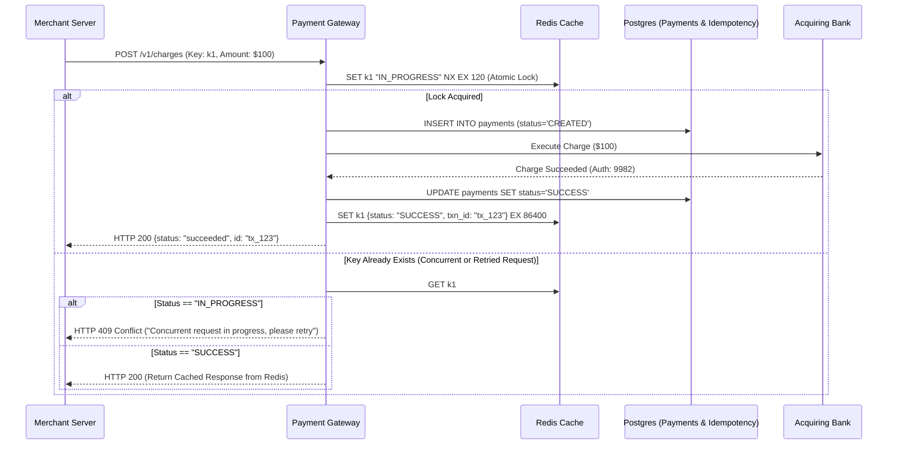
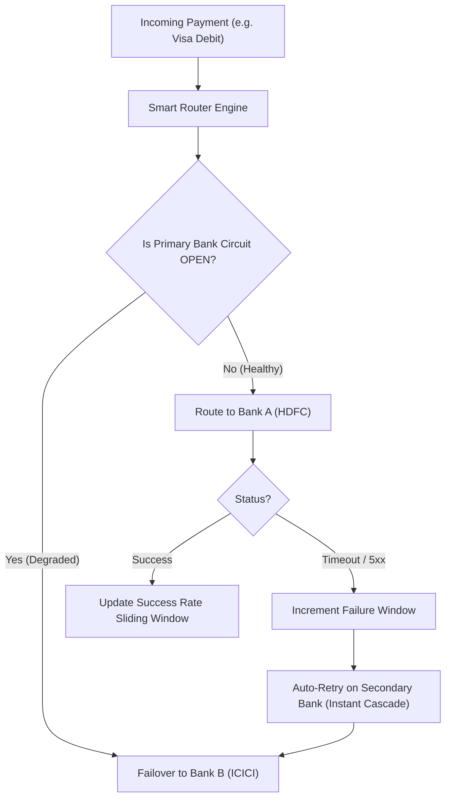
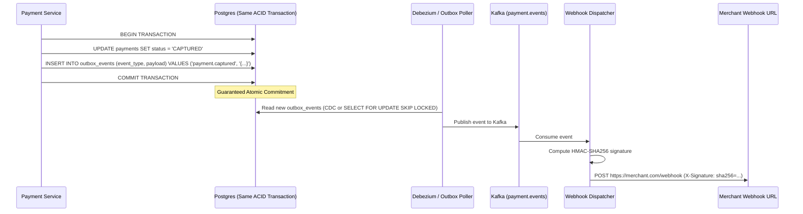
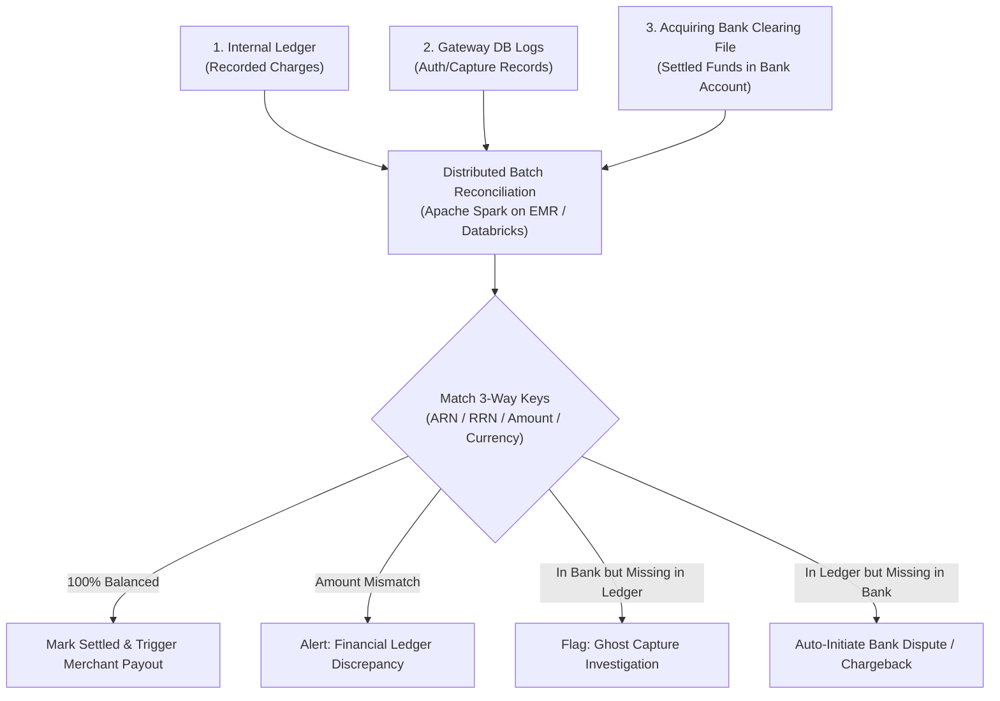

# High-Level Design: Planetary Payment Gateway & Distributed Ledger

This architecture guide synthesizes the system design patterns used by **Stripe (Stripe Payments & Stripe Ledger)** and **Razorpay (Payment Gateway & RazorpayX)** to process billions of dollars daily with 99.999% availability, zero financial data loss, and sub-second transaction latency.

---

## 1. System Requirements & Capacity Estimation

### Functional Requirements
1. **Idempotent Payment Ingestion:** Accept payments (`POST /v1/charges`) via Card, NetBanking, and UPI with guaranteed exactly-once charge execution.
2. **Dynamic Bank Gateway Routing:** Dynamically route traffic across multiple acquiring banks (HDFC, ICICI, Axis, Chase, Barclays) based on real-time success rates, fees, and latency.
3. **Double-Entry Financial Ledger:** Immutable ledger recording every balance movement with auditability and zero drift.
4. **Reliable Webhook Delivery:** Guaranteed at-least-once webhook event delivery to merchant backends with exponential backoff and HMAC signatures.
5. **Automated 3-Way Reconciliation:** Daily batch pipeline reconciling Merchant records, Gateway ledger, and Bank settlement files.

### Non-Functional Requirements & Capacity
* **Throughput:** 10,000 sustained RPS, peaking at **100,000 RPS** during mega sales (Diwali / Black Friday).
* **Availability:** **99.999% SLA** (< 5.26 minutes downtime per year).
* **Latency:** p99 API latency < 800ms (dominated by external 3DS/Banking network hops).
* **Durability:** Zero data loss ($RPO = 0$). Financial ledgers must be strictly ACID and auditable for 7+ years (PCI-DSS & regulatory mandates).

$$\text{Daily Volume} = 10{,}000 \text{ req/sec} \times 86{,}400 \text{ sec} \approx 864\text{ Million Transactions / Day}$$
$$\text{Storage per Transaction} \approx 1\text{ KB} \implies \sim 864\text{ GB / Day} \approx 315\text{ TB / Year (Uncompressed)}$$

---

## 2. End-to-End System Architecture

```mermaid
flowchart TD
    subgraph Clients["Merchant & Customer Tier"]
        Browser["Customer Browser / Mobile App (SDK)"]
        MerchantServer["Merchant Backend Server"]
    end

    subgraph EdgeTier["Edge & Security Tier"]
        WAF["Cloudflare WAF / DDoS Protection"]
        APIGW["Envoy API Gateway (TLS Termination & Rate Limiting)"]
    end

    subgraph CoreServices["Core Payment Orchestration"]
        IdemService["Idempotency Filter (Redis + Postgres)"]
        PaymentOrch["Payment Orchestrator (State Machine / Temporal)"]
        SmartRouter["Smart Bank Router & Health Checker"]
        TokenVault["PCI-DSS Card Tokenization Vault"]
    end

    subgraph ExternalBanks["Banking & Card Networks"]
        VisaMC["Visa / Mastercard Networks"]
        UPI["NPCI UPI Switch"]
        BankHDFC["HDFC Acquiring Gateway"]
        BankICICI["ICICI Acquiring Gateway"]
    end

    subgraph DataAndLedger["Storage & Financial Ledger"]
        PaymentDB[("PostgreSQL / CockroachDB (Payment States)")]
        LedgerDB[("Immutable Double-Entry Ledger (Sharded)")]
        Kafka["Kafka Event Stream (Order / Payment Events)"]
    end

    subgraph AsyncEcosystem["Asynchronous Processing Tier"]
        OutboxWorker["Transactional Outbox Relay Worker"]
        WebhookEngine["Webhook Delivery Engine (Backoff & DLQ)"]
        ReconEngine["3-Way Reconciliation Engine (Spark / EMR)"]
        DataLake[("S3 / BigQuery Financial Data Lake")]
    end

    Browser -->|Encrypted Card / UPI| APIGW
    MerchantServer -->|POST /v1/charges (Idempotency-Key)| APIGW
    WAF --> APIGW
    APIGW --> IdemService
    IdemService --> PaymentOrch
    PaymentOrch <--> TokenVault
    PaymentOrch --> SmartRouter
    SmartRouter --> VisaMC & UPI & BankHDFC & BankICICI

    PaymentOrch --> PaymentDB
    PaymentOrch --> LedgerDB
    PaymentDB -.-> OutboxWorker
    OutboxWorker --> Kafka
    Kafka --> WebhookEngine
    WebhookEngine -->|POST Webhook + HMAC| MerchantServer

    ExternalBanks -.->|End-of-Day Settlement CSV/MT940| ReconEngine
    LedgerDB -.-> ReconEngine
    ReconEngine --> DataLake
```

---

## 3. Deep-Dive Subsystem Blueprints

---

### Deep Dive 1: Planetary Idempotency Layer

Every mutating API request requires an `Idempotency-Key: <UUID>` header. The challenge is handling network disconnects, retries, and concurrent race conditions.



#### SQL Schema for Idempotency Invariants
```sql
CREATE TABLE idempotency_records (
    idempotency_key VARCHAR(128) NOT NULL,
    merchant_id VARCHAR(64) NOT NULL,
    request_hash CHAR(64) NOT NULL, -- SHA-256(request_payload)
    status VARCHAR(32) NOT NULL,    -- IN_PROGRESS, SUCCESS, FAILED
    response_code INT,
    response_body JSONB,
    created_at TIMESTAMP WITH TIME ZONE DEFAULT NOW(),
    expires_at TIMESTAMP WITH TIME ZONE NOT NULL,
    PRIMARY KEY (merchant_id, idempotency_key)
);
```

---

### Deep Dive 2: Smart Gateway Routing & Automated Circuit Breaking

Acquiring banks suffer from frequent latency degradation, network flakiness, and scheduled maintenance windows. A payment gateway cannot afford to blindly route all traffic to a single bank.

#### The Smart Routing Decision Engine
For every incoming card or UPI transaction, the **Smart Router** calculates an execution score:
$$\text{Score}(B) = w_1 \cdot \text{SuccessRate}_{5\text{min}}(B) + w_2 \cdot (1 - \text{LatencyP99}(B)) + w_3 \cdot (1 - \text{MDR\_Cost}(B))$$



* **Instant Cascade:** If Bank A times out or returns a temporary gateway error (`504 Gateway Timeout` or `ISSUER_DOWN`), the orchestrator automatically reroutes the payment token to Bank B **without prompting the customer to re-enter card details**.

---

### Deep Dive 3: The Transactional Outbox Pattern for Webhook Delivery

When a payment succeeds, merchants must be notified asynchronously via Webhooks (`payment.succeeded`).

> [!CAUTION]
> **Anti-Pattern:** Never publish to Kafka or make an HTTP webhook call inside the same database transaction that updates the payment record. If Kafka is down, the DB rolls back; if the DB commits but Kafka crashes before sending, the webhook is permanently lost.

#### The Transactional Outbox Solution


#### Webhook Retry Policy with Jitter
If the merchant's endpoint returns a `5xx` or times out, the webhook dispatcher applies exponential backoff with full jitter to avoid the thundering herd problem:
$$T_{\text{wait}} = \min(T_{\text{max}}, T_{\text{base}} \cdot 2^{\text{attempt}}) \times \text{Uniform}(0.5, 1.5)$$
Retried over 72 hours (up to 15 attempts) before routing to a Dead Letter Queue (DLQ).

---

### Deep Dive 4: Automated 3-Way Financial Reconciliation Engine

At midnight, the **Reconciliation Engine** executes a batch matching pipeline across three distinct sources of truth:



1. **3-Way Matching Keys:** Uses the Bank Reference Number (RRN) or Acquirer Reference Number (ARN), Currency, and Minor Unit Amount.
2. **Break Detection:** Automated detection of fee mismatches (interchange fee calculated by bank vs contracted rate) and ghost charges.
