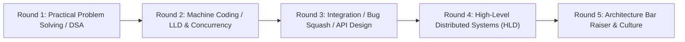
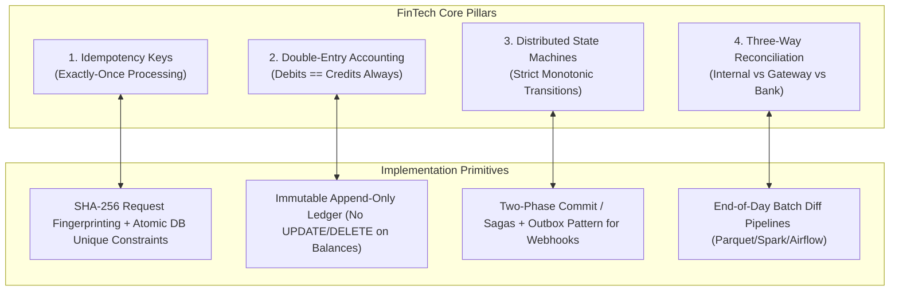

# Stripe & Razorpay — SDE-2, SDE-3 & Staff Technical Interview Preparation Guide

**Stripe** and **Razorpay** represent the gold standard of modern financial technology, payment gateway infrastructure, and developer-first APIs. While consumer-tech companies emphasize sub-second delivery or viral growth loops, FinTech engineering interviews evaluate candidates on **absolute financial correctness, zero-data-loss consistency, idempotency invariants, double-entry bookkeeping, and resilient distributed transactions**.

> *"In payments, a bug isn't just a 500 status code — it's real human money duplicated, lost, or trapped in an inconsistent state."*

---

## 1. Interview Loop Overview

Both Stripe and Razorpay maintain rigorous, practical engineering loops that minimize abstract trivia in favor of **real-world systems programming, production debugging, API design, and distributed ledger architecture**.

### Role Expectations Matrix

| Dimension | SDE-2 (~2.5 – 5 Years) | SDE-3 / Staff (~5 – 10+ Years) |
| :--- | :--- | :--- |
| **Problem Solving & DSA** | Clean, bug-free, production-style code in 45-60 min. Heavy focus on graphs, trees, rate limiting, and string parsing. | Complex algorithmic data structures, concurrency edge cases, and architectural abstractions. |
| **Machine Coding / LLD** | Working OOP code with concurrency control: Idempotent Payment Processor, Double-Entry Wallet, Rate Limiter. | Fault-tolerant event-driven state machines, distributed lock lease management, zero-drift balance calculations. |
| **API Design & Integration** | RESTful design, backward compatibility, idempotency keys, error schemas (`invalid_request_error`), webhook HMAC signatures. | API versioning strategies, multi-tenant rate limits, merchant data isolation, compliance (PCI-DSS, tokenization). |
| **High-Level Design (HLD)** | Payment gateway routing, payment retry queues, webhooks engine, Redis caching, Postgres ACID transactions. | Planetary payment orchestration, multi-region active-active ledger, 3-way banking reconciliation, 99.999% SLA. |
| **Culture & Values** | Extreme attention to detail, first-principles thinking, rigorous testing mindset. | Technical vision defense, post-mortem incident response, cross-functional risk assessment. |

---

## 2. Core FinTech Architectural Invariants

Every technical round at Stripe and Razorpay tests your understanding of these core financial engineering invariants:

### 1. Guaranteed Exactly-Once Execution (Idempotency)
* Every mutating API (`POST /v1/charges`, `POST /v1/refunds`, `POST /v1/payouts`) accepts an `Idempotency-Key` HTTP header.
* A incoming request calculates a cryptographic hash (SHA-256) of the request payload.
* If a concurrent or retried request arrives with the same key within a 24-hour TTL:
  - If the original request is **in-flight**: Return HTTP 409 Conflict or wait on a distributed lock.
  - If the original request has **completed**: Immediately return the cached response without re-executing the payment charge.

### 2. Double-Entry Bookkeeping Ledger
* Money is never created or destroyed out of thin air; it is only transferred between accounts.
* Every transaction consists of at least two entries:
  $$\sum \text{Debit Amounts} - \sum \text{Credit Amounts} = 0$$
* Balances are **derived projections** from an **immutable append-only ledger log** — you NEVER execute `UPDATE accounts SET balance = balance - 100`.

### 3. Payment Gateway Lifecycle & State Machine
* Payment state must progress strictly through deterministic transitions:
  $$\text{CREATED} \to \text{AUTHENTICATING (3DS/OTP)} \to \text{AUTHORIZED} \to \text{CAPTURED} \to \text{SETTLED}$$
* Terminal failure states (`FAILED`, `EXPIRED`, `REFUNDED`) are immutable.

---

## 3. Dedicated Playbook Modules

This guide is organized into three deep-dive preparation modules:

1. **[Machine Coding: Idempotent Payment Processor & Double-Entry Ledger](01_machine_coding_idempotent_payment_and_ledger.md)**  
   * Complete, compile-ready, multi-threaded implementation in Java & Python.
   * Atomic idempotency lock with request fingerprinting.
   * Multi-currency double-entry ledger with atomic journal entries and balance invariant assertions.

2. **[High-Level Design: Planetary Payment Gateway & Distributed Ledger](02_hld_payment_gateway_and_ledger.md)**  
   * 100,000+ RPS payment gateway architecture.
   * Bank gateway smart routing & fallback cascade (HDFC, ICICI, Axis, Visa/Mastercard, NPCI UPI).
   * Transactional Outbox Pattern for guaranteed webhook delivery.
   * Automated 3-way financial reconciliation engine.

3. **[Real Past Interview Questions Bank (Stripe & Razorpay)](03_past_interview_questions_bank.md)**  
   * 40+ verified past interview questions from actual Stripe and Razorpay technical loops.
   * LeetCode high-frequency algorithmic problem mappings.
   * System design, LLD machine coding, and Staff-level Bar Raiser scenarios.

---

## 🗺️ Cross-Referenced Master Study Modules

When preparing for Stripe & Razorpay loops, cross-reference these repository foundations:

* **For Concurrency & Thread Safety:**
  * [`01_core_foundations/java_concurrency_in_practice/`](../../01_core_foundations/java_concurrency_in_practice/README.md) (Locks, Atomic primitives, JMM)
  * [`01_core_foundations/java/concurrency/`](../../01_core_foundations/java/concurrency/README.md)
* **For Distributed Transactions & ACID:**
  * [`03_systems_and_databases/ddia_book_study/`](../../03_systems_and_databases/ddia_book_study/README.md) (Chapter 7: Transactions & Isolation, Chapter 9: Consistency & Consensus)
  * [`03_systems_and_databases/database_system_concepts/`](../../03_systems_and_databases/database_system_concepts/README.md) (ACID, 2PC, Isolation Levels)
* **For API Security & Zero-Trust:**
  * [`04_infrastructure/api_security_in_action/`](../../04_infrastructure/api_security_in_action/README.md) (OAuth2, HMAC Webhook Signatures, Tokenization)
* **For Infrastructure Deep Dives:**
  * [`04_infrastructure/tech-stack/relational-databases/`](../../04_infrastructure/tech-stack/relational-databases/README.md) (Postgres MVCC & `SKIP LOCKED`)
  * [`04_infrastructure/tech-stack/kafka/`](../../04_infrastructure/tech-stack/kafka/README.md) (Exactly-once stream processing)
