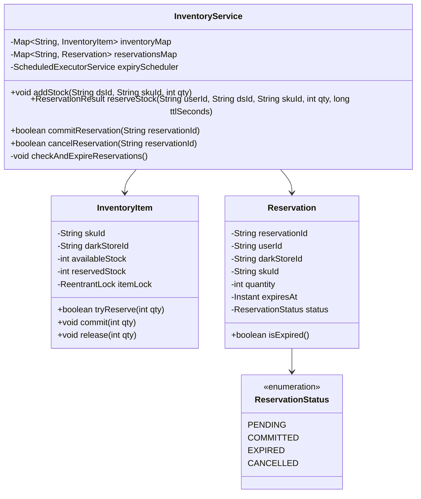

# Machine Coding: Flash-Sale Inventory Reservation Engine

> **Interview Problem Archetype:** Frequently asked in Zepto Round 2 (Machine Coding / LLD for SDE-2 & SDE-3).  
> **Duration:** 90 Minutes  
> **Evaluation Criteria:** Clean OOP (SOLID), Thread Safety, Concurrency Handling, In-Memory Data Storage, Unit Tests / Simulation Driver.

---

## 1. Problem Statement

Zepto operates hundreds of dark stores across metro cities. During high-demand events (e.g., Mango season, flash sales, festive rush), thousands of users attempt to purchase limited-stock items simultaneously.

You are required to design and implement an **In-Memory Flash-Sale Inventory Reservation Engine** that manages stock deduction and temporary cart reservations.

### Functional Requirements:
1. **Initialize Inventory:** Add SKUs to a specific `DarkStore` with initial quantities.
2. **Reserve Stock:** When a user adds an item to cart or initiates checkout, reserve $K$ units of `skuId` in `darkStoreId` for `ttlSeconds` (default: 10 minutes).
   * If available stock is insufficient, fail immediately (do not oversell).
   * Return a unique `ReservationId`.
3. **Confirm Purchase (Commit):** When payment succeeds, mark the reservation as `COMMITTED` and permanently decrement the reserved stock.
4. **Cancel Reservation (Release):** If the user empties cart or cancels, release the reserved stock back to available pool.
5. **Automatic Expiry:** If a reservation is neither committed nor cancelled within `ttlSeconds`, the system must automatically expire the reservation and restore the stock to the available pool.

### Non-Functional Requirements:
* **Strict Thread Safety:** Prevent race conditions when multiple threads attempt to reserve the last remaining stock unit.
* **Extensibility:** Clean separation of concerns (Model, Repository, Service, Concurrency Management).
* **Testability:** A driver program demonstrating concurrent reservation, commitment, and automated timeout restoration.

---

## 2. Low-Level Architecture & Class Diagram



---

## 3. Production Java Implementation

```java
package com.zepto.inventory;

import java.time.Instant;
import java.util.*;
import java.util.concurrent.*;
import java.util.concurrent.locks.ReentrantLock;

// ==========================================
// 1. Models & Enums
// ==========================================
enum ReservationStatus {
    PENDING,
    COMMITTED,
    EXPIRED,
    CANCELLED
}

class InventoryItem {
    private final String darkStoreId;
    private final String skuId;
    private int availableStock;
    private int reservedStock;
    private final ReentrantLock lock = new ReentrantLock();

    public InventoryItem(String darkStoreId, String skuId, int initialStock) {
        this.darkStoreId = darkStoreId;
        this.skuId = skuId;
        this.availableStock = initialStock;
        this.reservedStock = 0;
    }

    public boolean tryReserve(int quantity) {
        lock.lock();
        try {
            if (availableStock >= quantity) {
                availableStock -= quantity;
                reservedStock += quantity;
                return true;
            }
            return false;
        } finally {
            lock.unlock();
        }
    }

    public void commit(int quantity) {
        lock.lock();
        try {
            reservedStock -= quantity;
        } finally {
            lock.unlock();
        }
    }

    public void release(int quantity) {
        lock.lock();
        try {
            reservedStock -= quantity;
            availableStock += quantity;
        } finally {
            lock.unlock();
        }
    }

    public int getAvailableStock() {
        lock.lock();
        try {
            return availableStock;
        } finally {
            lock.unlock();
        }
    }

    public int getReservedStock() {
        lock.lock();
        try {
            return reservedStock;
        } finally {
            lock.unlock();
        }
    }
}

class Reservation {
    private final String reservationId;
    private final String userId;
    private final String darkStoreId;
    private final String skuId;
    private final int quantity;
    private final Instant expiresAt;
    private ReservationStatus status;

    public Reservation(String reservationId, String userId, String darkStoreId, String skuId, int quantity, Instant expiresAt) {
        this.reservationId = reservationId;
        this.userId = userId;
        this.darkStoreId = darkStoreId;
        this.skuId = skuId;
        this.quantity = quantity;
        this.expiresAt = expiresAt;
        this.status = ReservationStatus.PENDING;
    }

    public synchronized ReservationStatus getStatus() { return status; }
    public synchronized void setStatus(ReservationStatus status) { this.status = status; }
    public String getReservationId() { return reservationId; }
    public String getDarkStoreId() { return darkStoreId; }
    public String getSkuId() { return skuId; }
    public int getQuantity() { return quantity; }
    public Instant getExpiresAt() { return expiresAt; }
}

// ==========================================
// 2. Service Layer
// ==========================================
class InventoryReservationService {
    // Key: darkStoreId + ":" + skuId
    private final ConcurrentMap<String, InventoryItem> inventory = new ConcurrentHashMap<>();
    private final ConcurrentMap<String, Reservation> reservations = new ConcurrentHashMap<>();
    private final ScheduledExecutorService scheduler = Executors.newSingleThreadScheduledExecutor();

    public InventoryReservationService() {
        // Background task polling every 1 second to expire stale reservations
        scheduler.scheduleAtFixedRate(this::expireStaleReservations, 1, 1, TimeUnit.SECONDS);
    }

    private String getInventoryKey(String darkStoreId, String skuId) {
        return darkStoreId + ":" + skuId;
    }

    public void addStock(String darkStoreId, String skuId, int quantity) {
        String key = getInventoryKey(darkStoreId, skuId);
        inventory.compute(key, (k, existing) -> {
            if (existing == null) {
                return new InventoryItem(darkStoreId, skuId, quantity);
            } else {
                // If it already exists, release/add stock
                existing.release(-quantity); // Increases availableStock
                return existing;
            }
        });
    }

    public Optional<String> reserve(String userId, String darkStoreId, String skuId, int quantity, long ttlSeconds) {
        String key = getInventoryKey(darkStoreId, skuId);
        InventoryItem item = inventory.get(key);
        if (item == null) {
            System.err.println("❌ SKU " + skuId + " not found in Dark Store " + darkStoreId);
            return Optional.empty();
        }

        if (item.tryReserve(quantity)) {
            String reservationId = UUID.randomUUID().toString();
            Instant expiresAt = Instant.now().plusSeconds(ttlSeconds);
            Reservation res = new Reservation(reservationId, userId, darkStoreId, skuId, quantity, expiresAt);
            reservations.put(reservationId, res);
            return Optional.of(reservationId);
        }

        return Optional.empty(); // Out of stock
    }

    public boolean commit(String reservationId) {
        Reservation res = reservations.get(reservationId);
        if (res == null) return false;

        synchronized (res) {
            if (res.getStatus() != ReservationStatus.PENDING) {
                return false;
            }
            res.setStatus(ReservationStatus.COMMITTED);
            String key = getInventoryKey(res.getDarkStoreId(), res.getSkuId());
            InventoryItem item = inventory.get(key);
            if (item != null) {
                item.commit(res.getQuantity());
            }
            return true;
        }
    }

    public boolean cancel(String reservationId) {
        Reservation res = reservations.get(reservationId);
        if (res == null) return false;

        synchronized (res) {
            if (res.getStatus() != ReservationStatus.PENDING) {
                return false;
            }
            res.setStatus(ReservationStatus.CANCELLED);
            String key = getInventoryKey(res.getDarkStoreId(), res.getSkuId());
            InventoryItem item = inventory.get(key);
            if (item != null) {
                item.release(res.getQuantity());
            }
            return true;
        }
    }

    private void expireStaleReservations() {
        Instant now = Instant.now();
        for (Reservation res : reservations.values()) {
            synchronized (res) {
                if (res.getStatus() == ReservationStatus.PENDING && res.getExpiresAt().isBefore(now)) {
                    res.setStatus(ReservationStatus.EXPIRED);
                    String key = getInventoryKey(res.getDarkStoreId(), res.getSkuId());
                    InventoryItem item = inventory.get(key);
                    if (item != null) {
                        item.release(res.getQuantity());
                        System.out.println("⏰ [Auto-Expired] Reservation " + res.getReservationId() + 
                                           " timed out. Restored " + res.getQuantity() + " units to available stock.");
                    }
                }
            }
        }
    }

    public int getAvailableStock(String darkStoreId, String skuId) {
        InventoryItem item = inventory.get(getInventoryKey(darkStoreId, skuId));
        return item != null ? item.getAvailableStock() : 0;
    }

    public void shutdown() {
        scheduler.shutdown();
    }
}

// ==========================================
// 3. Driver Program / Concurrent Verification
// ==========================================
public class FlashSaleSimulationDriver {
    public static void main(String[] args) throws InterruptedException {
        InventoryReservationService service = new InventoryReservationService();

        String darkStoreId = "DS_INDIRANAGAR_04";
        String skuId = "ALPHONSO_MANGO_1KG";
        int initialStock = 5;

        service.addStock(darkStoreId, skuId, initialStock);
        System.out.println("📦 Initial Available Stock: " + service.getAvailableStock(darkStoreId, skuId));

        // Simulate 10 concurrent users attempting to reserve 1 unit each
        int threadCount = 10;
        ExecutorService executor = Executors.newFixedThreadPool(threadCount);
        CountDownLatch startLatch = new CountDownLatch(1);
        CountDownLatch doneLatch = new CountDownLatch(threadCount);
        List<String> successfulReservations = Collections.synchronizedList(new ArrayList<>());

        for (int i = 1; i <= threadCount; i++) {
            final String userId = "user_" + i;
            executor.submit(() -> {
                try {
                    startLatch.await(); // All threads blast simultaneously
                    Optional<String> resId = service.reserve(userId, darkStoreId, skuId, 1, 3); // 3 sec TTL
                    if (resId.isPresent()) {
                        System.out.println("✅ " + userId + " successfully reserved stock! ResId: " + resId.get());
                        successfulReservations.add(resId.get());
                    } else {
                        System.out.println("❌ " + userId + " failed to reserve: Out of Stock!");
                    }
                } catch (InterruptedException e) {
                    Thread.currentThread().interrupt();
                } finally {
                    doneLatch.countDown();
                }
            });
        }

        startLatch.countDown(); // FIRE ALL THREADS
        doneLatch.await();
        executor.shutdown();

        System.out.println("\n📊 Post-Burst Available Stock: " + service.getAvailableStock(darkStoreId, skuId));
        System.out.println("🎯 Total Successful Reservations: " + successfulReservations.size() + " (Must be exactly " + initialStock + ")");

        // Commit 2 reservations, leave 3 to expire
        if (successfulReservations.size() >= 2) {
            String r1 = successfulReservations.get(0);
            String r2 = successfulReservations.get(1);
            service.commit(r1);
            service.commit(r2);
            System.out.println("💳 Committed 2 reservations: " + r1 + ", " + r2);
        }

        System.out.println("\n⏳ Waiting 4 seconds for remaining reservations to expire...");
        Thread.sleep(4500);

        System.out.println("📈 Final Available Stock after TTL Expiry: " + service.getAvailableStock(darkStoreId, skuId) + " (Must be 3)");

        service.shutdown();
    }
}
```

---

## 4. Key Questions Asked During Defense

1. **How do you scale this from in-memory to distributed instances?**
   * *Answer:* Replace in-memory `ReentrantLock` with a distributed atomic script in **Redis** (`EVAL` with a Lua script performing atomic check-and-decrement), or database-level row locks with `UPDATE dark_store_inventory SET stock = stock - :qty WHERE sku_id = :id AND stock >= :qty`.
2. **What if the scheduler crashes while reservations are pending?**
   * *Answer:* Instead of relying solely on an in-memory timer, store `expires_at` in Redis as a Sorted Set (`ZADD reservations:expiry <timestamp> <res_id>`), allowing worker pods to continuously pull expired entries (`ZRANGEBYSCORE`).
