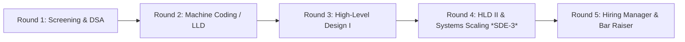
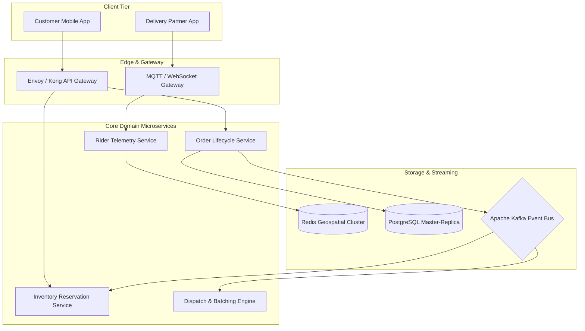

# Zepto — SDE-2 & SDE-3 Technical Interview Preparation Guide

Zepto is India's pioneer in **10-minute quick commerce**, operating a high-density network of automated **dark stores (micro-fulfillment centers)**. Because Zepto relies on sub-second inventory matching, ultra-low-latency order routing, and real-time rider batching, its technical interviews for **SDE-2 and SDE-3** prioritize **high concurrency, database locking mechanics, event-driven streaming, and clean, compile-ready machine coding**.

---

## 1. Interview Loop Overview

Zepto typically partners with specialized platforms (*BarRaiser* or *InterviewVector*) for the initial technical screening, followed by intensive in-house engineering and architectural rounds.



### Role Expectations Matrix

| Dimension | SDE-2 (~2.5 – 5 Years) | SDE-3 / Lead (~5 – 9+ Years) |
| :--- | :--- | :--- |
| **DSA Expectation** | 2 Medium/Hard questions solved with production code in 45-60 min. | 1-2 Medium problems emphasizing clean abstraction, edge conditions, and complexity. |
| **Machine Coding / LLD** | Working OOP code, GoF patterns, thread safety, unit tests. | Concurrency handling, multi-threading, DB schema design, transactional boundaries. |
| **High-Level Design (HLD)** | 1 Round: Microservices, Redis caching, Postgres indexing, API contracts. | 1 to 2 Rounds: Scalability to 10M orders/day, multi-region dark stores, Kafka partitioning, failure recovery. |
| **Culture & Leadership** | High ownership, agile feature execution, zero-bug mindset. | Architectural decision defense, cross-team outage handling, mentoring, tech strategy. |

---

## 2. Round-by-Round Breakdown & Core Focus Areas

---

### Phase 1: Problem Solving & Data Structures (DSA)
* **Format:** 60 Minutes (Live coding on HackerRank, CodePair, or Google Docs).
* **Speed Expectation:** Strict time limit. Interviewers expect optimized solutions upfront rather than taking 25 minutes building up from brute force.

#### High-Frequency LeetCode Problem Categories
1. **Graphs & Multi-Source BFS (Logistics & Map Traversal):**
   * [Rotting Oranges](https://leetcode.com/problems/rotting-oranges/) *(LeetCode 994 — Multi-source BFS simulation of propagation)*
   * [Bus Routes](https://leetcode.com/problems/bus-routes/) *(LeetCode 815 — Breadth-first graph optimization)*
   * [Course Schedule II](https://leetcode.com/problems/course-schedule-ii/) *(LeetCode 210 — Topological sorting for service dependencies)*
   * [Shortest Path in Binary Matrix](https://leetcode.com/problems/shortest-path-in-binary-matrix/) *(LeetCode 1091 — Shortest path with 8-directional movement)*
2. **Monotonic Stacks & Queues:**
   * [Daily Temperatures](https://leetcode.com/problems/daily-temperatures/) *(LeetCode 739)*
   * [Trapping Rain Water](https://leetcode.com/problems/trapping-rain-water/) *(LeetCode 42)*
   * [Sliding Window Maximum](https://leetcode.com/problems/sliding-window-maximum/) *(LeetCode 239 — Monotonic Deque)*
3. **Dynamic Programming & Greedy:**
   * [Minimum Cost For Tickets](https://leetcode.com/problems/minimum-cost-for-tickets/) *(LeetCode 983)*
   * [Best Time to Buy and Sell Stock with Cooldown](https://leetcode.com/problems/best-time-to-buy-and-sell-stock-with-cooldown/) *(LeetCode 309)*
   * [Coin Change](https://leetcode.com/problems/coin-change/) *(LeetCode 322)*
4. **Trees, Tries & Heap Queues:**
   * [Top K Frequent Elements](https://leetcode.com/problems/top-k-frequent-elements/) *(LeetCode 347 — Streaming data aggregation)*
   * [Implement Trie (Prefix Tree)](https://leetcode.com/problems/implement-trie-prefix-tree/) *(LeetCode 208 — Product catalog auto-complete)*

---

### Phase 2: Low-Level Design (LLD) & Machine Coding
* **Format:** 90–120 Minutes (Screen-share live coding in Java, Go, Python, or C++).
* **Expectation:** Fully working, compile-ready codebase with separated layers: Controller / API, Service, Repository, and Models.

#### Core Machine Coding Topics at Zepto:
* **Flash-Sale Inventory Reservation Engine:**
  * Prevent overselling under high concurrency.
  * Hold inventory for 10 minutes; automatically release if payment times out.
  * *See full runnable case study:* [`01_machine_coding_inventory_reservation.md`](01_machine_coding_inventory_reservation.md)
* **Dynamic Coupon & Promo Discount Engine:**
  * Support percentage discounts, flat cashback, buy-X-get-Y, and minimum cart value rules.
  * Chaining and mutual exclusion of coupons via **Strategy** and **Decorator** patterns.
* **Hyperlocal Delivery Partner Allocation:**
  * Find the nearest available rider within 1.5 km of a dark store.
  * Rider state machine: `IDLE` $\to$ `ACCEPTED` $\to$ `ARRIVED_AT_DARK_STORE` $\to$ `OUT_FOR_DELIVERY` $\to$ `DELIVERED`.
  * Support order batching (combining 2 nearby orders for a single rider).
* **Distributed In-Memory Rate Limiter:**
  * Token Bucket or Sliding Window Log implementation with lock-free atomic operations.

---

### Phase 3: High-Level System Design (HLD)
* **Format:** 60 Minutes (Excalidraw, Miro, or Architecture Diagram).
* **Expectation:** End-to-end distributed system, capacity estimation, data schema, sharding, caching, and edge-case failure mitigation.



#### Core HLD Questions at Zepto:
1. **Design Zepto's 10-Minute Dark-Store & Order Allocation Engine:**
   * Geofencing, dark store inventory allocation, picking route inside dark store, rider batching within 10-minute SLAs.
   * *See detailed design:* [`02_hld_dark_store_10min_delivery.md`](02_hld_dark_store_10min_delivery.md)
2. **Real-Time Rider Telemetry & Live Tracking System:**
   * Ingesting 50,000 GPS pings/second; low-latency geospatial indexing with Uber H3 or S2.
3. **High-Throughput Notification Service:**
   * Order status push notifications, SMS, WhatsApp alerts with deduplication, priority queues, and backpressure.

---

## 3. Engineering Deep Dives: What SDE-2/3 Interviewers Grill On

### A. Database Concurrency & Row-Level Locking
* **Pessimistic vs. Optimistic Locking:**
  * Why optimistic locking (`WHERE version = @v`) fails under heavy flash sales (leads to high retry failure rates).
  * Why `SELECT ... FOR UPDATE` can cause database lock contention, and how `SELECT ... FOR UPDATE SKIP LOCKED` allows background workers to poll queues without blocking one another.
* **Conditional Atomic Updates:**
  ```sql
  -- Safe atomic stock deduction without heavy pessimistic table locks
  UPDATE dark_store_inventory 
  SET stock = stock - :quantity, updated_at = NOW()
  WHERE dark_store_id = :dsId 
    AND sku_id = :skuId 
    AND stock >= :quantity;
  ```

### B. Apache Kafka & Event-Driven Architecture
* **Partitioning Strategy:** To guarantee strict sequential processing of an order's lifecycle (`ORDER_CREATED` $\to$ `PICKING` $\to$ `PACKED` $\to$ `DISPATCHED`), use `order_id` as the message key.
* **Consumer Lag & Backpressure:** How to prevent consumer starvation during 8 PM dinner-rush spikes.
* **Transactional Outbox Pattern:** Solving dual-write inconsistency between PostgreSQL order state and Kafka event publication using Change Data Capture (Debezium).

### C. Redis & Caching Strategies
* **Preventing Cache Stampede (Thundering Herd):** Probabilistic early expiration (XFetch algorithm) or distributed mutex (Redlock / singleflight) when a hot SKU cache expires.
* **Geospatial Indexing:** Using Redis `GEOADD` and `GEORADIUS` / `GEOSEARCH` to find riders within $R$ meters of dark store coordinates.

---

## 4. Behavioral & Leadership (Bar Raiser)

Zepto values **extreme ownership, bias for action, and resilience** in a 24/7 mission-critical operational environment.

### Frequently Asked Behavioral Questions:
1. **Production Incident:** *"Tell me about the worst production outage you caused or debugged. How did you identify the root cause, what was the MTTD/MTTR, and what systemic guardrails did you put in place?"*
2. **Technical Disagreement:** *"Describe a situation where Product insisted on an aggressive deadline that risked system stability. How did you negotiate scope or architecture trade-offs?"*
3. **Handling Ambiguity:** *"Tell me about a time you had to build a system with minimal specifications. What assumptions did you validate first?"*
4. **Mentorship (SDE-3):** *"How do you mentor engineers to write production-ready code? How do you handle repeated code review friction?"*

---

## 📚 Zepto Preparation Module Navigation

* **[Machine Coding: Inventory Reservation Engine](01_machine_coding_inventory_reservation.md)** — Fully runnable Java/Go LLD implementation with concurrency safety and automated expiry.
* **[High-Level Design: 10-Minute Dark-Store Dispatch](02_hld_dark_store_10min_delivery.md)** — Production architecture with H3 geospatial indexing, Kafka streaming, and capacity math.
* **[Comprehensive Past Questions Bank](03_past_interview_questions_bank.md)** — Curated list of actual questions asked in recent SDE-2 & SDE-3 Zepto interview rounds.
