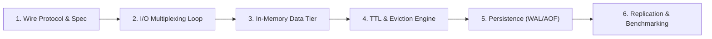

# 06. Learning Projects (Build Your Own Systems from Scratch)

Welcome to the **Learning Projects** section of the 2026 Master Preparation Repository. While reading architectural books, studying system designs, and practicing algorithmic problems build foundational knowledge, the true hallmark of Staff Engineers, Systems Architects, and Infrastructure Specialists is **mechanical sympathy gained by implementing canonical systems from scratch**.

> *"What I cannot create, I do not understand."*  
> — **Richard Feynman**

---

## 🧭 Why Build Systems from Scratch?

Building systems from scratch bridges the chasm between theoretical understanding and real-world implementation invariants:

1. **First-Principles Mechanical Sympathy:**  
   Understanding how the Linux kernel handles non-blocking sockets (`epoll`, `kqueue`, edge vs level triggering), memory allocation arenas, CPU cache lines, zero-copy syscalls (`sendfile`, `splice`), and memory-mapped files (`mmap`).
2. **Protocol & Serialization Mastery:**  
   Parsing custom binary and text wire protocols (such as RESP, HTTP/1.1 framing, Kafka binary record batches), dealing with partial frames, TCP packet fragmentation, and pipelining.
3. **Data Structure Internals:**  
   Writing production-grade hash tables with progressive incremental rehashing, SkipLists with ranking, circular ring buffers, and LSM-tree SSTables with Bloom filters.
4. **Crash Recovery & Concurrency:**  
   Implementing write-ahead logging (WAL), Append-Only Files (AOF) with background rewriting via OS `fork()` and Copy-on-Write, Raft consensus invariants, and lock-free thread synchronizers.

---

## 🏗️ Systems Projects Catalogue

| Project | Focus Domain | Key Concepts | Status | Documentation & Code |
| :--- | :--- | :--- | :---: | :--- |
| **Redis from Scratch** | In-Memory Key-Value Store & Distributed Cache | Event Loop (`epoll`), RESP2/RESP3 parser, incremental rehashing, TTL active/passive eviction, AOF persistence (`fork()` rewrite), Master-Replica replication | 🟢 **Active** | **[`redis/`](redis/README.md)** |
| **MiniDB Storage Engine** | Embedded Key-Value Storage | LSM-Tree, MemTable SkipList, WAL journaling, immutable SSTables, Bloom filters, Leveled compaction | 🟢 **Available** | **[`03_systems_and_databases/minidb/`](../03_systems_and_databases/minidb/)** |
| **High-Performance Event Loop & HTTP Server** | Networking & Asynchronous I/O | Reactor Pattern, non-blocking POSIX sockets, HTTP/1.1 chunked transfer, keep-alive connection pooling | 🟡 Planned | *Milestone 2* |
| **Raft Distributed Consensus Engine** | Distributed Systems & Fault Tolerance | Leader Election, Log Replication, Safety Invariants, Dynamic Membership Changes, Log Compaction | 🟡 Planned | *Milestone 3* |
| **Git from Scratch** | Content-Addressable Storage | Blob, Tree, Commit SHA-1 objects, index staging area, packfile delta compression, DAG commit graph | 🟡 Planned | *Milestone 4* |
| **Container Runtime from Scratch** | Linux Systems & OS Isolation | Linux Namespaces (`CLONE_NEWPID`, `CLONE_NEWNET`), cgroups v2 resource limits, OverlayFS rootfs mounting | 🟡 Planned | *Milestone 5* |

---

## 🚀 Flagship Project: Redis from Scratch

The first flagship implementation project in this section is **Redis from Scratch**:

* **Project Guide & Roadmap:** [`redis/README.md`](redis/README.md)
* **Architecture & Event Loop Blueprint:** [`redis/01_architecture_and_roadmap.md`](redis/01_architecture_and_roadmap.md)
* **RESP Protocol Specification:** [`redis/02_resp_protocol_specification.md`](redis/02_resp_protocol_specification.md)
* **Internal Data Structures & TTL:** [`redis/03_internals_and_data_structures.md`](redis/03_internals_and_data_structures.md)
* **Persistence & Replication:** [`redis/04_persistence_and_replication.md`](redis/04_persistence_and_replication.md)
* **Starter Implementations & Test Suite:**
  * **[Python Event-Driven Starter (`selectors` / `epoll`)](redis/starter/python/)**
  * **[C++20 Starter Template](redis/starter/cpp/)**
  * **[Automated Test Suite (`test_redis_server.py`)](redis/tests/)**

---

## 🎯 Implementation Strategy

When building any project in this section, follow this staff-level engineering workflow:

1. **Start with the Interface:** Always implement the wire protocol (RESP) first and verify against the official client (`redis-cli`).
2. **Build Non-Blocking I/O Early:** Avoid thread-per-connection anti-patterns; leverage a single-threaded event loop with non-blocking I/O multiplexing (`epoll`/`kqueue`/`select`).
3. **Write Automated Property Tests:** Test partial packet transmission, socket disconnects, pipelined requests, and concurrent workloads.
4. **Benchmark Rigorously:** Run real-world benchmarks (`redis-benchmark -q -n 100000 -c 50 -P 16`) to measure throughput and latency percentiles (p50, p99).
