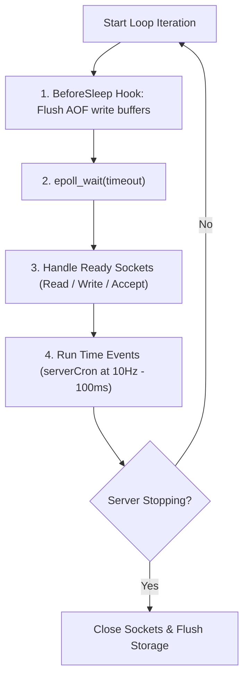

# 01. Redis Architecture, Event Loop & Implementation Roadmap

To build a high-performance Redis server from scratch, you must understand the architectural invariants that allow Redis to handle hundreds of thousands of operations per second on a single thread.

---

## 1. The Reactor Pattern & Single-Threaded Invariants

Traditional relational databases and multi-threaded servers spin up a thread per connection or dispatch incoming sockets to a thread pool. While multi-threading allows multi-core parallelism, it introduces:

1. **Context Switching Overhead:** Thousands of concurrent threads cause excessive kernel-to-user-space context switches.
2. **Lock Contention:** Shared in-memory data structures (hash tables, trees) require coarse locks (`mutex`) or complex lock-free concurrency primitives, degrading throughput under high write contention.
3. **Cache Line Bouncing:** Multi-socket SMP CPUs constantly invalidate L1/L2/L3 cache lines when modifying shared state across cores.

Redis circumvents these problems by employing the **Single-Threaded Reactor Pattern** (inspired by Douglas Schmidt's Reactor Pattern):

```mermaid
sequenceDiagram
    participant OS as Linux Kernel (epoll)
    participant Loop as Event Loop (ae.c)
    participant Client as TCP Client Socket
    participant Storage as In-Memory Dict

    Loop->>OS: epoll_wait(timeout = 100ms)
    Note over OS: Client sends "SET key val\r\n"
    OS-->>Loop: Ready Event (fd = Client Socket, EPOLLIN)
    Loop->>Client: read(fd, buffer)
    Loop->>Loop: Parse RESP Command ["SET", "key", "val"]
    Loop->>Storage: ht_set(key, val)
    Storage-->>Loop: OK
    Loop->>Client: write(fd, "+OK\r\n")
    Loop->>Storage: Active Expiration Cron Tick
```

> [!NOTE]
> Even though Redis 6.0 introduced threaded I/O for socket reading and writing, the **command execution engine remains strictly single-threaded**. Commands execute sequentially in isolation, eliminating race conditions without requiring application-level locks.

---

## 2. Linux I/O Multiplexing Mechanics

At the core of Redis is `ae.c` (A Simple Event-Driven Library). On Linux, it wraps `epoll`; on BSD/macOS, it wraps `kqueue`; on generic POSIX, it falls back to `select` or `poll`.

### POSIX Non-Blocking Socket Setup

Sockets must be placed into non-blocking mode (`O_NONBLOCK`). Otherwise, a slow client or network stall on `read()` or `write()` will block the entire server!

```c
// C / POSIX non-blocking socket configuration
int flags = fcntl(fd, F_GETFL, 0);
fcntl(fd, F_SETFL, flags | O_NONBLOCK);
```

In Python:
```python
client_sock.setblocking(False)
```

In Java NIO:
```java
socketChannel.configureBlocking(false);
```

### Edge-Triggered vs. Level-Triggered

* **Level-Triggered (Default in Redis):** `epoll_wait` notifies you as long as there is unread data in the kernel receive buffer. This makes partial reads simpler to handle.
* **Edge-Triggered (`EPOLLET`):** `epoll_wait` notifies you only when a state transition occurs (e.g., new data arrives). You MUST drain the socket in a `while(true)` loop until `EAGAIN` or `EWOULDBLOCK`.

---

## 3. Buffer Management & Framing

TCP is a **stream-oriented protocol**, not a message-oriented protocol. There are no packet boundaries! A client command:
```
*3\r\n$3\r\nSET\r\n$4\r\nname\r\n$6\r\nKartik\r\n
```
May arrive:
1. In one complete chunk.
2. In fragmented fragments (e.g., `*3\r\n$3\r\nSE` in packet 1, and `T\r\n...` in packet 2).
3. Batched together with multiple subsequent commands (**pipelining**).

### The Per-Connection Buffer Model

Every client connection must maintain:
* **`read_buffer`:** Accumulates raw bytes received from `recv()` / `read()`. The RESP parser scans this buffer for complete frames. Once a command is parsed, consumed bytes are sliced away.
* **`write_buffer`:** Accumulates outbound responses. If the socket write buffer is full, the remaining response bytes are queued until `EPOLLOUT` fires.

---

## 4. The Event Loop Lifecycle

A production-grade event loop repeats three discrete steps every iteration:



### The Role of `serverCron` (Time Events)
`serverCron` runs at a configured frequency (default: 10Hz, or every 100 milliseconds). Its responsibilities:
1. **Active Key Expiration:** Samples random keys with TTL and deletes expired ones.
2. **Software Watchdog & Stats:** Updates memory usage metrics and connected client count.
3. **Incremental Dict Rehashing:** Moves a small batch of buckets from `ht[0]` to `ht[1]` to keep latency low.
4. **Trigger Background Persistence:** Checks if AOF rewrite or RDB snapshot criteria are met.

---

## 5. Detailed 10-Milestone Roadmap

### Milestone 1: TCP Server & I/O Multiplexer
- Open listening TCP socket on `0.0.0.0:6379`.
- Set `SO_REUSEADDR` to allow immediate restarts.
- Register listening socket with `epoll` / `select` / `selectors`.
- Accept inbound client connections, set them non-blocking, and track them in a client table.

### Milestone 2: RESP Protocol Serializer & Deserializer
- Implement streaming parser for RESP 2 data types (`+`, `-`, `:`, `$`, `*`).
- Handle chunked/partial reads without blocking or dropping connections.
- Implement response serializer for strings, integers, errors, and arrays.

### Milestone 3: Core Key-Value Store
- Create in-memory dictionary for strings.
- Implement router for:
  - `PING` (returns `+PONG\r\n` or `$msg_len\r\n$msg\r\n`)
  - `ECHO <msg>`
  - `SET <key> <val>`
  - `GET <key>`
  - `DEL <key> [<key> ...]`
  - `EXISTS <key> [<key> ...]`
  - `INCR <key>` / `DECR <key>`

### Milestone 4: Key Expiration & TTL
- Maintain a secondary dictionary `expires` mapping `key -> unix_timestamp_ms`.
- Support `SET key val EX <seconds>` and `SET key val PX <milliseconds>`.
- Implement `EXPIRE`, `PEXPIRE`, `TTL`, `PTTL`, and `PERSIST`.
- Implement **Passive Expiration:** Delete key on access if expired.
- Implement **Active Expiration:** Random sampling in `serverCron`.

### Milestone 5: Complex Data Structures
- Implement **Lists:** Linked list / circular deque with `LPUSH`, `RPUSH`, `LPOP`, `RPOP`, `LRANGE`, `LLEN`.
- Implement **Hashes:** Sub-dictionary with `HSET`, `HGET`, `HDEL`, `HEXISTS`, `HGETALL`.
- Implement **Sets:** Hash set with `SADD`, `SREM`, `SISMEMBER`, `SMEMBERS`, `SCARD`.
- Implement **Sorted Sets:** SkipList + Hash Table for `ZADD`, `ZRANK`, `ZSCORE`, `ZRANGE`.

### Milestone 6: AOF Persistence (Append-Only File)
- Log all state-mutating commands (`SET`, `DEL`, `EXPIRE`) to disk in RESP format.
- Implement `fsync` policies: `always`, `everysec`, `no`.
- On server startup, replay the AOF log to reconstruct state.

### Milestone 7: AOF Rewrite & RDB Snapshotting
- Implement `BGREWRITEAOF` using Linux `fork()`:
  - Child process iterates over `db.dict` and writes minimal reconstruction commands.
  - Parent continues serving writes, accumulating a child diff buffer.
  - Parent swaps old AOF with new rewritten AOF atomically.

### Milestone 8: Memory Eviction Policies
- Track `used_memory`.
- When `used_memory > maxmemory`:
  - `volatile-lru`: Evict oldest keys with TTL.
  - `allkeys-lru`: Evict oldest keys across all entries.
  - `noeviction`: Reject writes with an out-of-memory error.

### Milestone 9: Transactions
- Implement `MULTI`, `EXEC`, `DISCARD`.
- Queue client commands when transaction is active.
- Execute entire queue atomically upon `EXEC`.
- Implement optimistic locking with `WATCH`.

### Milestone 10: Master-Replica Replication
- Implement `REPLCONF` and `PSYNC`.
- Master streams command mutations to connected replicas.
- Replicas acknowledge processed byte offsets.
