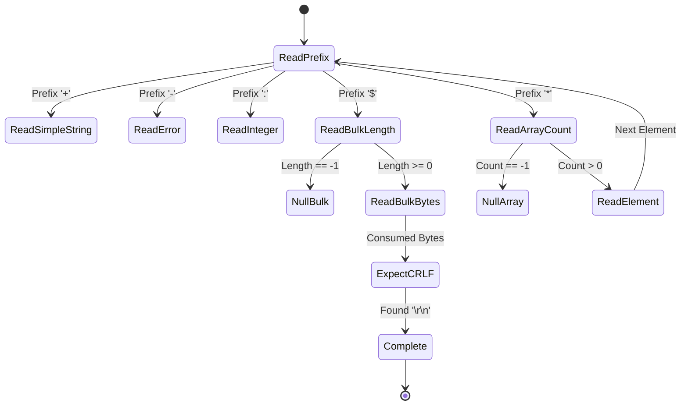

# 02. RESP (REdis Serialization Protocol) Specification & Parsing

Redis clients and servers communicate over raw TCP using **RESP (REdis Serialization Protocol)**. It is a text-based, binary-safe wire protocol engineered for:
1. Fast human readability and ease of debugging.
2. Extremely fast zero-copy deserialization in C/C++/Java.
3. Strict binary safety (can transmit arbitrary raw bytes, images, or serialized objects).

---

## 1. Frame Types and Prefix Characters

Every message in RESP 2 begins with an ASCII identifier byte indicating the payload type:

| Type | Prefix | Description | Example Wire Format | Parsed Value |
| :--- | :---: | :--- | :--- | :--- |
| **Simple String** | `+` | Lightweight non-binary ASCII status messages (cannot contain `\r` or `\n`). | `+OK\r\n` | `"OK"` |
| **Simple Error** | `-` | Error message returned when command execution fails. | `-ERR unknown command 'FOO'\r\n` | `Exception("ERR ...")` |
| **Integer** | `:` | 64-bit signed ASCII integer. | `:1000\r\n` | `1000` |
| **Bulk String** | `$` | Binary-safe string prefixed with byte length. Can contain arbitrary bytes. | `$5\r\nhello\r\n` | `b"hello"` |
| **Null Bulk** | `$` | Represents nonexistent key or nil result. | `$-1\r\n` | `None` / `null` |
| **Array** | `*` | Ordered list of RESP elements (can nest arrays). | `*2\r\n$3\r\nGET\r\n$3\r\nfoo\r\n` | `["GET", "foo"]` |
| **Null Array** | `*` | Represents empty/null array. | `*-1\r\n` | `None` / `null` |

---

## 2. In-Depth Wire Representation

### A. Simple Strings (`+`)
Simple strings are terminated by `\r\n` (CRLF) and cannot contain binary null bytes or newline characters. Used primarily for status replies:
```
+OK\r\n
+PONG\r\n
```

### B. Simple Errors (`-`)
Errors are formatted similarly to Simple Strings, but the client treats them as an exception. By convention, the first word is the error category (e.g., `ERR`, `WRONGTYPE`):
```
-ERR unknown command 'xyz'\r\n
-WRONGTYPE Operation against a key holding the wrong kind of value\r\n
```

### C. Integers (`:`)
Carries 64-bit signed numbers (e.g. from `INCR`, `DEL`, `LLEN`):
```
:1\r\n
:0\r\n
:-1\r\n
```

### D. Bulk Strings (`$`)
Bulk strings are **binary safe**. The format is:
`$<length>\r\n<raw_bytes>\r\n`

For example, `"hello"` (length 5):
```
$5\r\nhello\r\n
```
An empty string `""` (length 0):
```
$0\r\n\r\n
```
A **Null Bulk String** (representing a missing key in `GET non_existent`):
```
$-1\r\n
```

### E. Arrays (`*`)
Client requests are ALWAYS sent as an **Array of Bulk Strings**.
The format is:
`*<count>\r\n<element_1><element_2>...<element_N>`

For example, the command `SET mykey "hello world"` is transmitted as an array of 3 bulk strings:
```
*3\r\n
$3\r\n
SET\r\n
$5\r\n
mykey\r\n
$11\r\n
hello world\r\n
```

On the wire, this is:
```
*3\r\n$3\r\nSET\r\n$5\r\nmykey\r\n$11\r\nhello world\r\n
```

---

## 3. Streaming Parser Architecture

Because TCP streams arrive in unpredictable chunks, a production parser must be **non-blocking and resumable**:



### The Line-Scanning Algorithm

When parsing a line terminated by `\r\n`:
1. Search the `read_buffer` for `b"\r\n"`.
2. If `b"\r\n"` is NOT found:
   - The frame is incomplete! **Do not block.**
   - Retain the buffer and return `None` (need more bytes).
3. If `b"\r\n"` is found:
   - Slice line: `line = buffer[:crlf_pos]`.
   - Advance buffer index: `buffer = buffer[crlf_pos + 2:]`.

### Bulk String Byte-Count Slicing

For `$5\r\nhello\r\n`:
1. Parse length `5`.
2. Verify buffer has at least `5 + 2` bytes remaining (data + `\r\n`).
3. If not, wait for subsequent `socket.recv()`.
4. Slice exactly 5 bytes: `data = buffer[:5]`.
5. Verify `buffer[5:7] == b"\r\n"`.
6. Advance buffer by `5 + 2 = 7` bytes.

---

## 4. Handling Pipelining

Clients frequently send multiple commands without waiting for previous responses (**Command Pipelining**):

```
*1\r\n$4\r\nPING\r\n*1\r\n$4\r\nPING\r\n*1\r\n$4\r\nPING\r\n
```

A well-architected parser processes this inside a `while` loop:
```python
def process_client_buffer(client):
    while True:
        command, consumed_bytes = parse_resp(client.read_buffer)
        if command is None:
            # Need more data from socket
            break
        client.read_buffer = client.read_buffer[consumed_bytes:]
        response = execute_command(command)
        client.write_buffer += serialize_resp(response)
```
This guarantees maximum throughput and zero latency spikes during bulk data loading.
