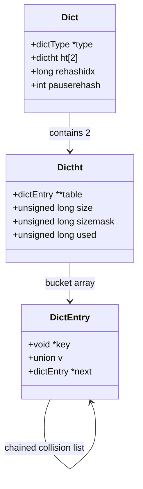
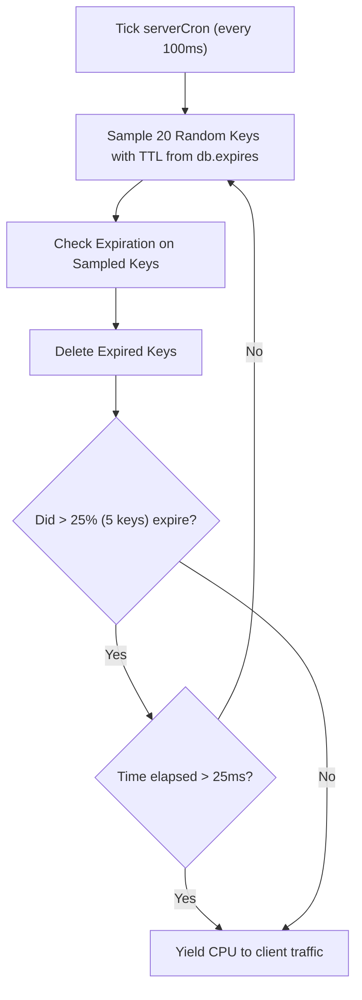

# 03. Redis Internals & Data Structures Implementation

In Redis, raw performance is achieved by meticulously selecting and engineering specialized C data structures that maximize cache locality, eliminate memory reallocation, and avoid latency spikes.

---

## 1. Simple Dynamic Strings (SDS)

Redis never uses plain C null-terminated strings (`char*`). Instead, it uses **Simple Dynamic Strings (SDS)**:

```c
struct __attribute__ ((__packed__)) sdshdr8 {
    uint8_t len;        // Used bytes (string length)
    uint8_t alloc;      // Total allocated buffer capacity
    unsigned char flags;// Header type (sdshdr5, 8, 16, 32, 64)
    char buf[];         // Actual raw character bytes
};
```

### Why SDS Over Standard C Strings?
1. **$O(1)$ Length Lookups:** `strlen(s)` requires an $O(N)$ memory scan in C. In SDS, `len` is stored directly in the header.
2. **Binary Safety:** Standard C strings terminate on the first null byte (`\0`). SDS uses `len` to delimit string boundaries, allowing arbitrary binary data (images, protobufs, encrypted tokens).
3. **Buffer Overflow Prevention:** Functions like `sdscat()` check `alloc - len` before appending. If insufficient space exists, it dynamically reallocates with pre-allocated buffer room (doubling capacity up to 1MB).

---

## 2. In-Memory Hash Table (`dict.c`) & Incremental Rehashing

The heart of Redis storage is `dict.c`. Unlike Java's `ConcurrentHashMap` or C++'s `std::unordered_map` which resize in a single stop-the-world operation, Redis implements **Incremental Rehashing**.

### Structure of a Redis Dictionary
Every Redis dictionary contains **two hash tables**:
* `ht[0]`: The primary active hash table.
* `ht[1]`: The migration hash table used during rehashing.
* `rehashidx`: Index of the bucket currently being migrated (set to `-1` when not rehashing).



### The Progressive Rehashing Algorithm
When `used / size >= 1` (or `>= 5` during background saves):
1. Allocate `ht[1]` with `size * 2` (rounded to next power of 2).
2. Set `rehashidx = 0`.
3. **Step-by-Step Migration:**
   - Every time a command performs a lookup, insert, or delete (`dictFind`, `dictAdd`), Redis migrates **1 bucket** from `ht[0]` to `ht[1]`.
   - In `serverCron` (every 100ms), Redis allocates up to 1ms to migrate a batch of 100 buckets.
4. **Lookup Logic During Rehashing:**
   - First check `ht[0]`.
   - If not found, check `ht[1]`.
5. **Completion:** Once all buckets are migrated, `ht[0] = ht[1]`, clear `ht[1]`, and set `rehashidx = -1`.

> [!IMPORTANT]
> This guarantees that hash table resizing **never causes latency spikes**, maintaining sub-millisecond p99 response times even with 50 million keys.

---

## 3. Key Expiration & TTL Architecture

Redis stores expirations using a **Dual-Dictionary Architecture**:

```
server.db[0]
  ├── dict:    { "user:1" -> "Alice", "user:2" -> "Bob", "cache:item" -> "data" }
  └── expires: { "cache:item" -> 1731000000000 }  (UNIX timestamp in milliseconds)
```

Expirations are evaluated using two complementary mechanisms: **Passive Eviction** and **Active Eviction**.

### 1. Passive Eviction (Lazy Deletion on Access)
Whenever any command accesses a key (`GET`, `EXISTS`, `HGET`, etc.):
```python
def lookup_key(key):
    # 1. Check if key exists in db.expires
    if key in db.expires:
        expire_time = db.expires[key]
        if current_time_ms() >= expire_time:
            # Key has expired! Delete from both tables
            del db.dict[key]
            del db.expires[key]
            propagate_del_to_aof_and_replicas(key)
            return None
    return db.dict.get(key)
```

### 2. Active Eviction (Probabilistic Cron Sampling)
Passive eviction alone causes a memory leak if keys are set with TTL but never accessed again. To solve this, `serverCron` runs an **Active Expiration Cycle (10 times per second)**:



* Capping the loop at 25ms ensures the server never locks up while reclaiming memory!

---

## 4. SkipList Implementation for Sorted Sets (`zset`)

Sorted Sets (`ZADD`, `ZRANGE`, `ZSCORE`, `ZRANK`) require two operations simultaneously:
1. Fast point lookup by member: `ZSCORE key member` $\rightarrow O(1)$.
2. Fast range queries by score: `ZRANGEBYSCORE key min max` $\rightarrow O(\log N + M)$.

Redis pairs an internal `dict` (member $\rightarrow$ score) with a **SkipList (zskiplist)**:

```
Level 3:  [Header] -----------------------------------------------------> [Score 90] -> NULL
Level 2:  [Header] ------------------------> [Score 50] -----------------> [Score 90] -> NULL
Level 1:  [Header] ----------> [Score 20] -> [Score 50] -> [Score 70] -> [Score 90] -> NULL
Level 0:  [Header] -> [10] -> [Score 20] -> [Score 50] -> [Score 70] -> [Score 90] -> NULL
```

### SkipList Node Layout
```c
typedef struct zskiplistNode {
    sds ele;                            // Member value
    double score;                       // Score
    struct zskiplistNode *backward;     // Backward pointer for reverse traversals
    struct zskiplistLevel {
        struct zskiplistNode *forward;  // Next node at this level
        unsigned long span;             // Number of nodes spanned (for O(log N) ZRANK)
    } level[];
} zskiplistNode;
```

* **Span:** By storing how many nodes are skipped at each level pointer, Redis calculates the rank of any element (`ZRANK`) in $O(\log N)$ time without traversing intermediate nodes.
* **Randomized Level Generation:** Each node's level is determined by a geometric coin-flip distribution ($p = 0.25$, max levels = 32 or 64).
