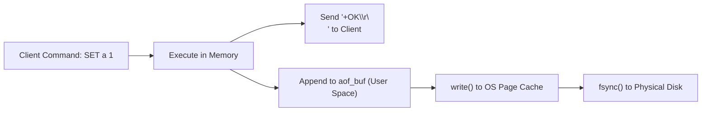
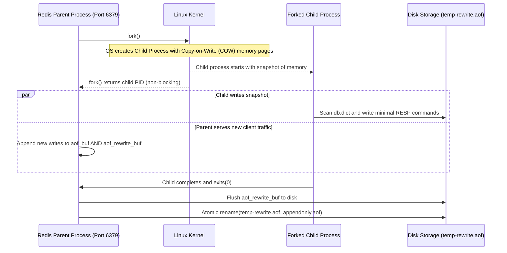
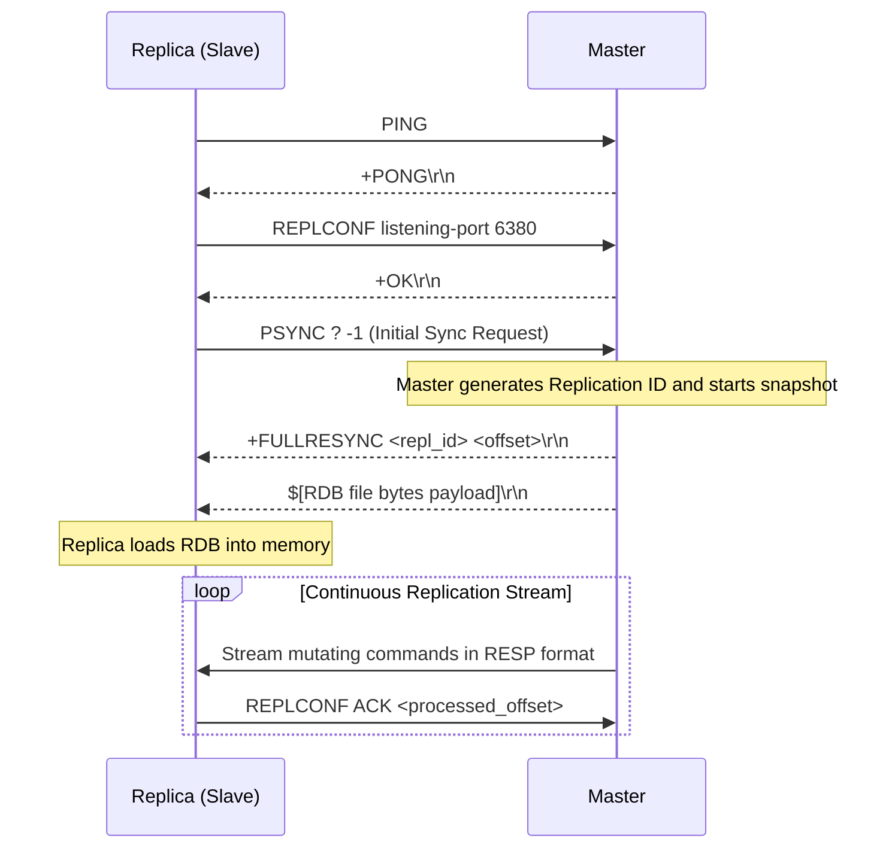

# 04. Persistence (AOF & RDB) & Master-Replica Replication

Redis combines in-memory execution speed with durable persistence and high availability through two primary subsystems: **Persistence (AOF & RDB)** and **Replication (`PSYNC`)**.

---

## 1. Append-Only File (AOF) Architecture

The **Append-Only File (AOF)** logs every mutating command (`SET`, `DEL`, `EXPIRE`, `HSET`) in standard RESP protocol format to an append-only disk log.



### The Three `appendfsync` Policies

| Policy | Calling Mechanism | Data Loss Window | Throughput Impact |
| :--- | :--- | :--- | :--- |
| **`always`** | Calls `fsync()` after *every single command*. | Zero (strictly durable). | Severe (limited by disk rotational/NAND IOPS). |
| **`everysec`** (Default) | Background thread calls `fsync()` once per second. | At most 1–2 seconds of writes. | Near-maximum throughput (~100k ops/sec). |
| **`no`** | Relies on Linux kernel flushing (usually every 30 seconds). | Up to 30 seconds. | Maximum (pure memory-speed writes). |

---

## 2. AOF Rewrite (`BGREWRITEAOF`) via `fork()` and Copy-on-Write

If you run `INCR counter` 1,000,000 times, an unmodified AOF log will store 1,000,000 entries. But the current state is just:
```
SET counter 1000000
```
An **AOF Rewrite** reconstructs the minimal set of commands required to recreate current memory state from scratch.

### The Background Rewrite Workflow



> [!TIP]
> **Why `fork()` instead of a thread?**  
> In POSIX systems, `fork()` clones the entire virtual address space using hardware **Copy-on-Write (COW)**. The child process sees a frozen point-in-time snapshot of the database without acquiring a single lock or pausing parent execution!

---

## 3. RDB (Redis Database) Snapshots

**RDB** produces a compact, single-file binary serialization of the in-memory dataset:
* Triggered by `BGSAVE` (background `fork()`) or `SAVE` (synchronous, blocks main thread).
* Extremely fast to recover during server boot compared to parsing millions of text AOF commands.
* Uses checksum verification (CRC64) and LZF string compression.

---

## 4. Master-Replica Replication Protocol (`PSYNC`)

Redis supports asynchronous, non-blocking master-replica replication to deliver read scalability and disaster recovery.



### The Replication Backlog (Ring Buffer)
The master maintains a fixed-size in-memory circular ring buffer (**Replication Backlog**, default 1MB).
* If a replica disconnects momentarily (network hiccup), it reconnects with:
  ```
  PSYNC <cached_repl_id> <last_received_offset>
  ```
* If `last_received_offset` is still present in the master's backlog ring buffer, the master sends `+CONTINUE` and streams only the missing diff (**Partial Resynchronization**), avoiding expensive RDB dump and transfer cycles!
