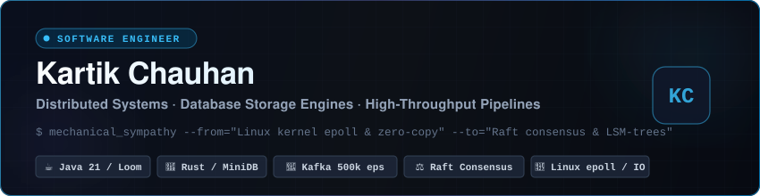

<div align="center">

  <a href="https://chauhankartik.github.io">
    
  </a>

  <br/><br/>

  <!-- Status & Quick Badges -->
  <a href="https://chauhankartik.github.io">
    
  </a>
  <a href="https://chauhankartik.github.io/cv.html">
    
  </a>
  <a href="https://chauhankartik.github.io/roadmap.html">
    
  </a>
  <a href="mailto:kartikchauhan987@gmail.com">
    
  </a>
  <a href="https://github.com/chauhankartik">
    
  </a>

</div>

---

### ⚡ Executive Summary

I am a **Software Engineer** specializing in distributed systems, backend infrastructure, and database storage engines. Driven by first-principles engineering and mechanical sympathy, my focus spans low-level Linux systems programming and high-concurrency JVM internals up to fault-tolerant consensus invariants, LSM-tree storage engines, and event-driven architectures.

```bash
$ cat << 'EOF' > ethos.txt
"Design with mechanical sympathy for the hardware, 
 zero-cost abstraction for the runtime, 
 and rigorous fault tolerance for the network."
EOF
```

- 🏛️ **Architecture & Scale**: Proven track record architecting event-driven platforms processing **500,000+ events/sec** with zero-copy I/O.
- 💾 **Storage Internals**: Hands-on implementer of Write-Ahead Logging (WAL), MemTable SkipLists, binary SSTables, and background compaction algorithms.
- ☕ **High-Concurrency Runtimes**: Deep expertise in JVM internals, Java 21 Project Loom virtual threads, JMM memory barriers, and lock-free CAS primitives.
- 📚 **Engineering Hub**: Author of the **[2026 Master Systems Architecture & Study Hub](https://chauhankartik.github.io)**, synthesizing 800+ technical guides, 509 Markdown docs, and 283 Java masterclasses.

---

### 🚀 Featured Systems & Flagship Projects

<table>
  <thead>
    <tr>
      <th width="35%">Project</th>
      <th width="45%">Architecture & Highlights</th>
      <th width="20%">Key Metrics</th>
    </tr>
  </thead>
  <tbody>
    <tr>
      <td>
        <b>🦀 <a href="https://chauhankartik.github.io/topic.html?path=03_systems_and_databases/minidb">MiniDB Storage Engine</a></b><br/>
        <sub>Embedded LSM-Tree Key-Value Engine</sub><br/>
        <code>Rust</code> <code>LSM-Tree</code> <code>WAL</code> <code>SSTable</code>
      </td>
      <td>
        High-performance embedded storage engine implemented in Rust. Features append-only Write-Ahead Logging (WAL) for durability, lock-free MemTable SkipList for high write ingestion, binary SSTable layout with Bloom Filters, and background leveled compaction.
      </td>
      <td>
        • <b>P99 Write</b>: &lt; 0.8ms<br/>
        • <b>Bloom Filter</b>: 1% FPR<br/>
        • <b>Zero Data Loss</b> on crash
      </td>
    </tr>
    <tr>
      <td>
        <b>⚡ <a href="https://chauhankartik.github.io/topic.html?path=02_system_design/hld/02_distributed_id_generator_snowflake.md">Twitter Snowflake ID Generator</a></b><br/>
        <sub>Distributed 64-bit ID Generation</sub><br/>
        <code>Java 21</code> <code>Lock-Free CAS</code> <code>Atomic</code>
      </td>
      <td>
        High-concurrency, coordinate-free unique 64-bit ID generator based on Twitter Snowflake. Eliminates cross-datacenter network consensus while maintaining strict time-sortability and sub-millisecond sequence rollover with NTP clock-skew protection.
      </td>
      <td>
        • <b>4,096 IDs/ms</b> per worker<br/>
        • <b>Zero</b> consensus rounds<br/>
        • <b>Lock-Free</b> atomic bit shifts
      </td>
    </tr>
    <tr>
      <td>
        <b>🌊 <a href="https://chauhankartik.github.io/topic.html?path=04_infrastructure/high_throughput_data_pipelines">Streaming Pipeline Engine</a></b><br/>
        <sub>Zero-Copy Event Ingestion Architecture</sub><br/>
        <code>Kafka</code> <code>Linux Kernel</code> <code>sendfile()</code>
      </td>
      <td>
        High-throughput event streaming pipeline utilizing Apache Kafka, partitioned consumer group rebalances, and Linux kernel PageCache socket transfers via <code>sendfile()</code>. Implements Transactional Outbox and idempotent consumer semantics.
      </td>
      <td>
        • <b>500k+</b> events/sec<br/>
        • <b>Zero-Copy</b> socket I/O<br/>
        • <b>Exactly-Once</b> guarantees
      </td>
    </tr>
    <tr>
      <td>
        <b>🧠 <a href="https://chauhankartik.github.io">2026 Master Study & Prep Hub</a></b><br/>
        <sub>Systems Engineering & Architecture Platform</sub><br/>
        <code>Distributed Systems</code> <code>DDIA</code> <code>OSTEP</code>
      </td>
      <td>
        A production-grade, 13-week curriculum covering 800+ technical modules. Synthesizes canonical textbooks (DDIA, OSTEP, Effective Java, Database Internals), university courses (MIT 6.5840, Stanford CS244B), and 28 real-world Alex Xu high-level design systems.
      </td>
      <td>
        • <b>800+</b> technical guides<br/>
        • <b>509</b> deep-dive docs<br/>
        • <b>283</b> Java masterclasses
      </td>
    </tr>
    <tr>
      <td>
        <b>🏛️ <a href="https://chauhankartik.github.io/index.html#projects">Production LLD Engine Suite</a></b><br/>
        <sub>Production Low-Level Design Engine</sub><br/>
        <code>Design Patterns</code> <code>SOLID</code> <code>Concurrency</code>
      </td>
      <td>
        Production implementations of core systems: Thread-safe multi-threaded LRU Cache with MPSC write buffers, concurrent Elevator Dispatching Engine, Multi-Floor Parking Lot, and distributed Token Bucket Rate Limiters with ArchUnit boundary verification.
      </td>
      <td>
        • <b>5</b> full case studies<br/>
        • <b>Hexagonal</b> architecture<br/>
        • <b>Thread-Safe</b> invariants
      </td>
    </tr>
  </tbody>
</table>

---

### 🛠️ Technical Competencies & Arsenal

<table width="100%">
  <tr>
    <td width="25%" valign="top">
      <h4>💻 Systems & Runtimes</h4>
      <ul>
        <li><b>Java</b> (21, Loom, JMM, AQS)</li>
        <li><b>Rust</b> (Ownership, Lifetimes, Tokio)</li>
        <li><b>C++ / C</b> (RAII, Move Semantics, Pointers)</li>
        <li><b>Go</b> (Goroutines, Channels)</li>
        <li><b>Python</b> (AsyncIO, CPython internals)</li>
      </ul>
    </td>
    <td width="25%" valign="top">
      <h4>⚖️ Distributed & Consensus</h4>
      <ul>
        <li><b>Consensus</b> (Raft, 2PC, Paxos)</li>
        <li><b>Theorems</b> (CAP, PACELC, FLP)</li>
        <li><b>Patterns</b> (Saga, Outbox, CDC)</li>
        <li><b>Sharding</b> (Consistent Hashing, Quorum)</li>
        <li><b>Gossip Protocols</b> & Failure Detectors</li>
      </ul>
    </td>
    <td width="25%" valign="top">
      <h4>💾 Storage & Databases</h4>
      <ul>
        <li><b>Storage Engines</b> (LSM-Trees, B+ Trees)</li>
        <li><b>Recovery</b> (WAL, ARIES, Checkpointing)</li>
        <li><b>Relational</b> (PostgreSQL, MySQL MVCC)</li>
        <li><b>In-Memory / NoSQL</b> (Redis Cluster, Cassandra)</li>
        <li><b>Compaction</b> (Size-Tiered, Leveled)</li>
      </ul>
    </td>
    <td width="25%" valign="top">
      <h4>☁️ Infra & Cloud Native</h4>
      <ul>
        <li><b>Streaming</b> (Apache Kafka, Debezium)</li>
        <li><b>Networking</b> (Linux <code>epoll</code>, Zero-Copy)</li>
        <li><b>Containers</b> (Docker, Kubernetes)</li>
        <li><b>Gateways</b> (Envoy, NGINX, mTLS)</li>
        <li><b>Observability</b> (Prometheus, Grafana, Jaeger)</li>
      </ul>
    </td>
  </tr>
</table>

---

### 📖 Canonical Foundations & Mental Models

My engineering framework is grounded in foundational computer science literature and canonical university curricula:

- 🎓 **MIT 6.5840 (6.824)**: Distributed Systems *(MapReduce, Raft Consensus, Primary-Backup, 2PC)*
- 🎓 **Stanford CS244B**: Advanced Distributed Systems *(P2P DHTs, Byzantine Fault Tolerance, Quorum Replication)*
- 📘 **DDIA (Martin Kleppmann)**: *Designing Data-Intensive Applications* *(SSTables, Replication Lag, Linearizability)*
- 📗 **OSTEP (Remzi & Andrea Arpaci-Dusseau)**: *Operating Systems: Three Easy Pieces* *(Virtualization, Concurrency, File Systems)*
- 📙 **Database Internals (Alex Petrov)**: *B-Trees, LSM-Trees, Page Cache, and Distributed Storage Engines*

---

### 📊 GitHub Activity & Dynamic Analytics

<div align="center">
  <table border="0">
    <tr>
      <td align="center" width="50%">
        
      </td>
      <td align="center" width="50%">
        
      </td>
    </tr>
    <tr>
      <td colspan="2" align="center">
        
      </td>
    </tr>
  </table>
</div>

---

### 🤝 Connect & Collaborate

<div align="center">

  <a href="https://chauhankartik.github.io">
    
  </a>
  &nbsp;
  <a href="https://chauhankartik.github.io/cv.html">
    
  </a>
  &nbsp;
  <a href="mailto:kartikchauhan987@gmail.com">
    
  </a>
  &nbsp;
  <a href="https://github.com/chauhankartik">
    
  </a>

  <br/><br/>
  <sub>⚡ Engineered with mechanical sympathy by <b>Kartik Chauhan</b></sub>

</div>
